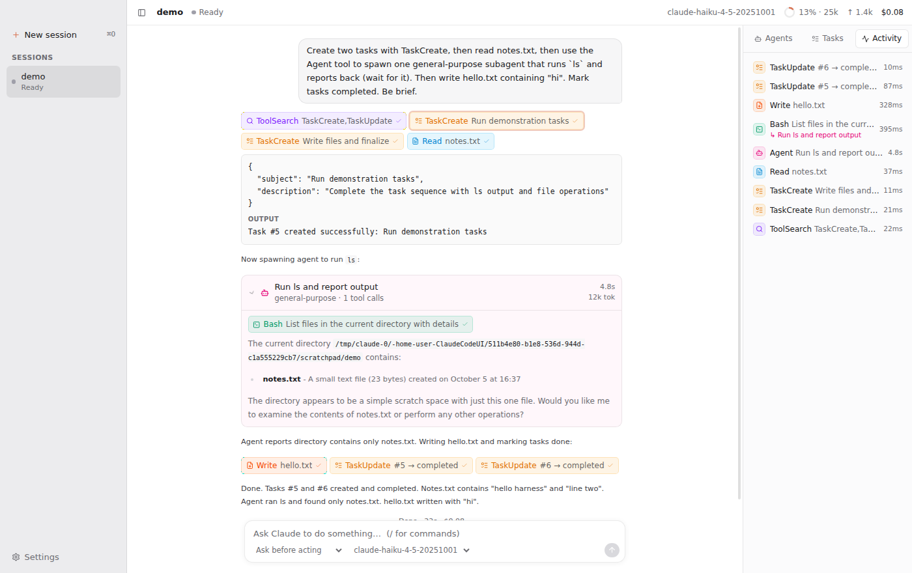

# Harness

A Mac app that runs Claude Code and shows what it's doing as it happens: streamed replies, every tool call, subagents, the task list, context usage and cost.



## Status

Phases 1–2 of [the plan](docs/PLAN.md) are done:

- **Engine:** Claude Agent SDK with streaming input, so you can queue follow-ups while Claude works. Stop with Esc. Switch model and permission mode mid-session.
- **Live conversation:** streamed markdown, collapsible thinking, and compact tool chips coloured by kind (read, write, search, exec…). Click a chip to see its input, output and diff.
- **Subagents:** each spawned agent gets a live card with its own tool calls, a progress summary and its final report. Background subagents keep running after the turn ends.
- **Permission cards:** Allow (⏎) / Always allow / Deny (⎋), with a diff preview. The dock badge and bounce fire while the app is in the background.
- **Inspector:** a tree of agents (current tool, elapsed time, tokens), the task list (from `TaskCreate`/`TaskUpdate` or `TodoWrite`), and a log of every tool call.
- **Top bar:** context-window gauge, output tokens, session cost, turn timer.
- **Focus mode** (⌘\\), open project (⌘O), settings (⌘,).


## Run it

```bash
npm install
npm run dev          # launches the app with hot reload
```

Requirements: macOS, Node 20+. Sessions use your existing Claude Code login. You can also store an Anthropic API key under **Settings**; it's encrypted with your macOS Keychain. Sessions load your usual `~/.claude` settings, CLAUDE.md files, MCP servers and skills.

```bash
npm test             # normalizer/reducer tests replay real recorded SDK sessions
npm run typecheck
npm run build:mac    # .dmg in dist/ (unsigned unless you configure a Developer ID)
```

## How it works

```
Claude Agent SDK ──▶ EventNormalizer ──▶ HarnessEvent stream ──▶ IPC (batched ~30fps) ──▶ reducer ──▶ React panels
      ▲                (main process)                                                  (renderer)
      └── canUseTool ◀── PermissionBroker ◀── permission card
```

Everything the UI shows is derived from one typed event stream (`src/shared/events.ts`). Live view now, and history/replay later, run on the same reducer.

| Path | What |
| --- | --- |
| `src/main/agent/AgentService.ts` | One SDK `query()` per session, fed by a push queue; status tracking; interrupt |
| `src/main/agent/permissions.ts` | `canUseTool` ↔ UI round-trip |
| `src/main/events/normalizer.ts` | SDK messages → `HarnessEvent`s (tools, subagents, tasks, usage) |
| `src/main/events/bus.ts` | Batches events to the renderer |
| `src/renderer/src/stores/reducer.ts` | Events → session state (pure; unit-tested) |
| `src/renderer/src/features/` | Conversation, agents, tasks, meters |
| `test/fixtures/` | Real SDK sessions recorded for tests |
