# Harness

A Mac app that runs Claude Code and shows what it's doing as it happens: streamed replies, every tool call, subagents, the task list, context usage and cost.

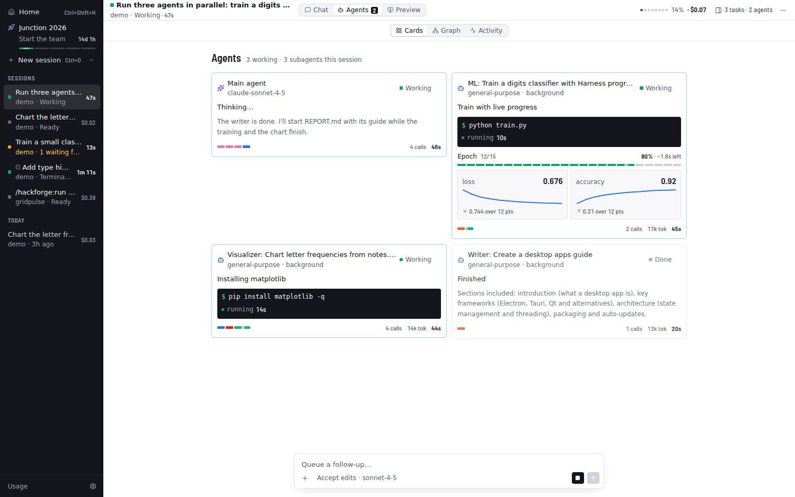

## Watching agents work

**Board** (⌘2) shows every agent as a live card. Each card shows:

- **What it's doing now:** the file it's writing streams in, a running command shows its line and timer, a search shows its query.
- **Progress bars** with an ETA, and **metric charts** (loss, accuracy, …).
- **The latest result it showed:** an image, chart, table or note.
- **A strip of its tool calls**, coloured by kind.

Click a card for the full detail view: progress, one chart per metric, all results, the files it touched (click to see the diff), its whole timeline and its report.

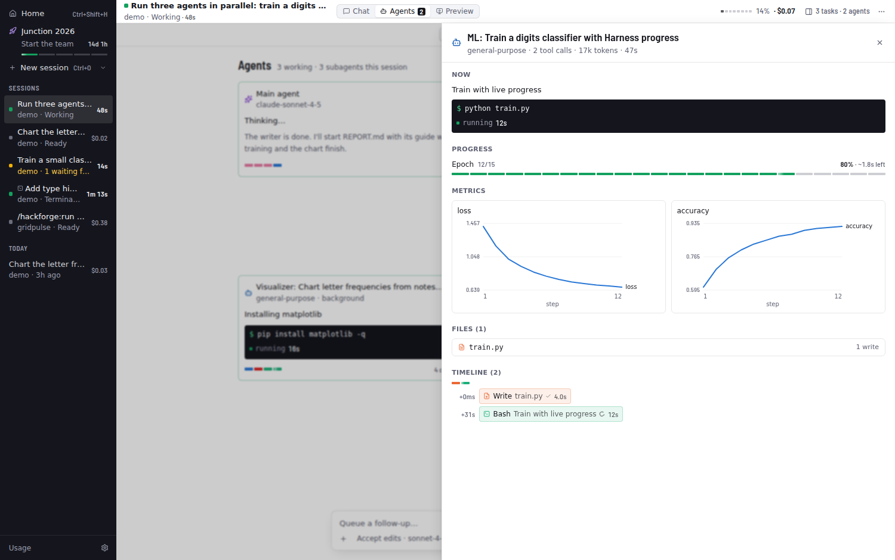

Agents feed these visuals three ways:

1. **`harness` tools.** Every agent has in-process MCP tools: `status`, `progress`, `metric` and `show`. `show` takes an image path, markdown, a table or a chart. Claude calls them between steps.
2. **`$HARNESS_URL`.** Scripts the agent runs can POST JSON there while they execute, so a training loop updates its progress bar and charts in real time. The format matches the tools, e.g. `{"kind": "progress", "label": "epoch", "current": 3, "total": 10, "metrics": {"loss": 0.42}}`.
3. **Command output.** tqdm bars, `Epoch 3/10` and `loss=0.42`-style lines are parsed automatically.

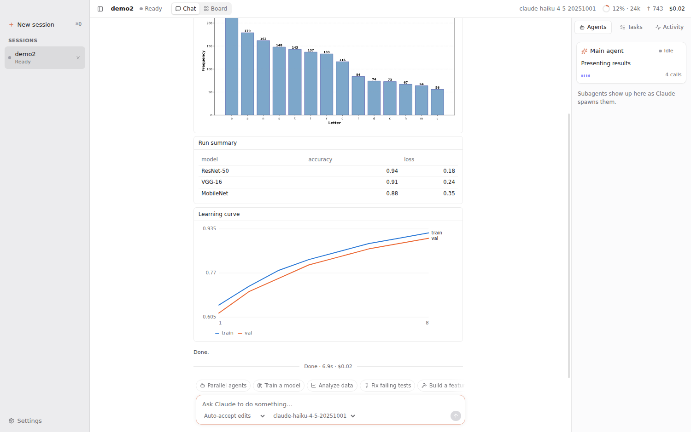

## Mission control, files and diffs

**Mission** (⌘3) puts two views together. On top is a live **agent graph**: the main agent and every subagent it spawns, nested by who spawned whom. Edges animate while an agent works, and each node shows its current activity, progress and recent tool calls. Below is a **timeline** with one lane per agent and a bar per tool call (colour = kind, length = duration). Parallel calls stack, and a shaded band shows each subagent's lifetime. Hover a bar for details, click it to open that call in its agent's detail view, and switch between All and Last 2 min.

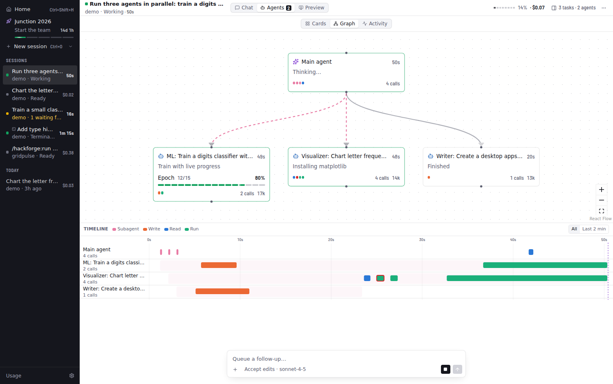

The **Files** tab in the inspector has two parts:

- **Changes:** every file that differs from how it was before the session, with +/− counts.
- **Project tree:** a heat map where files glow blue when read, orange when written, and green when a command changed them, fading over about a minute. Folders containing touched files open automatically. Dots record what ever happened to each file.

Click a changed file for a **Monaco diff** (side by side or inline, unchanged regions folded). Step through files with the arrows, **Revert** to restore the original, or **Accept** to mark it reviewed.

How the "before" is known: the SDK's `PreToolUse` hook snapshots each file just before an agent edits it. Files changed by commands fall back to git's `HEAD` version. Snapshots are saved with the session, so diffs and reverts still work after a restart or from History.

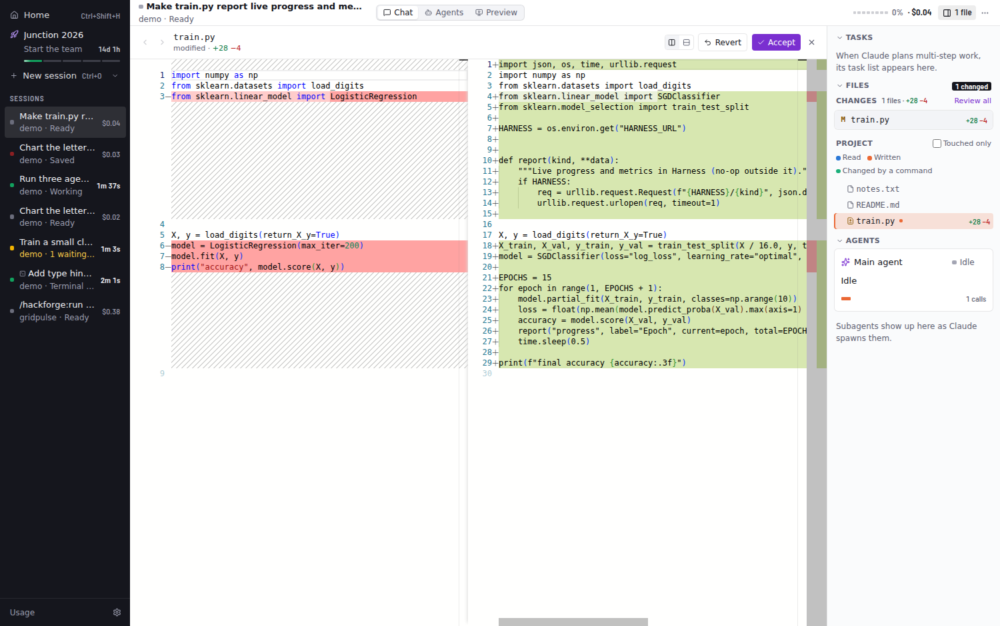

## Terminal and observe mode

**Terminal** (⌘J, or the terminal icon in the top bar) is a panel of real terminals built on node-pty and xterm.js. They open in the session's project and use your login shell, so your PATH, aliases and tools work. Tabs keep their scrollback while hidden. **✳ Claude** opens the interactive Claude Code CLI in a tab.

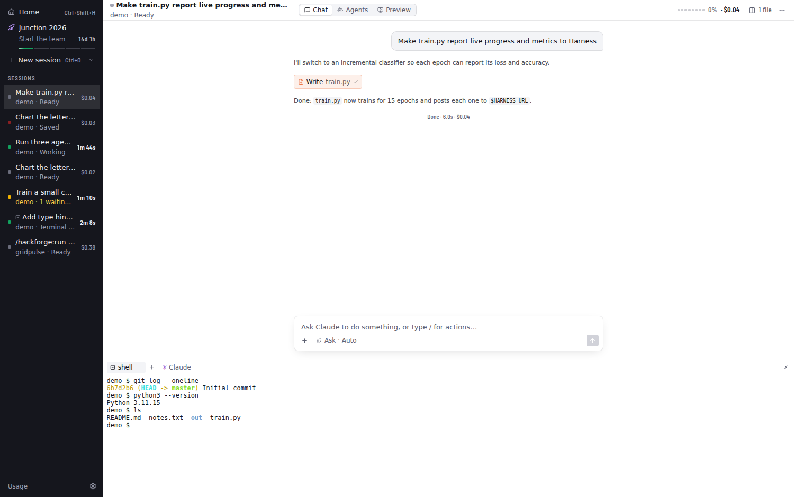

**Observe mode** shows Claude Code sessions you start outside Harness (iTerm, Terminal, an editor, `claude -p` in a script) in the sidebar with a terminal icon. You get the full live UI for them: conversation, Board, Mission graph and timeline, files and cost. It needs no setup. Harness watches the transcripts Claude Code writes to `~/.claude/projects/`, attributes subagent work through each subagent's metadata file, and saves the session to History so you can resume it later. Sessions Harness runs itself, and other Agent SDK apps, are skipped.

For instant "needs approval", "done" and "ended" status, **Settings → Install hooks** adds a tiny `curl` hook for four events to `~/.claude/settings.json`. The file is backed up first, existing hooks are kept, and **Remove hooks** takes out only Harness's entries. The hook never blocks or fails Claude Code (`curl -m 1 … || true`).

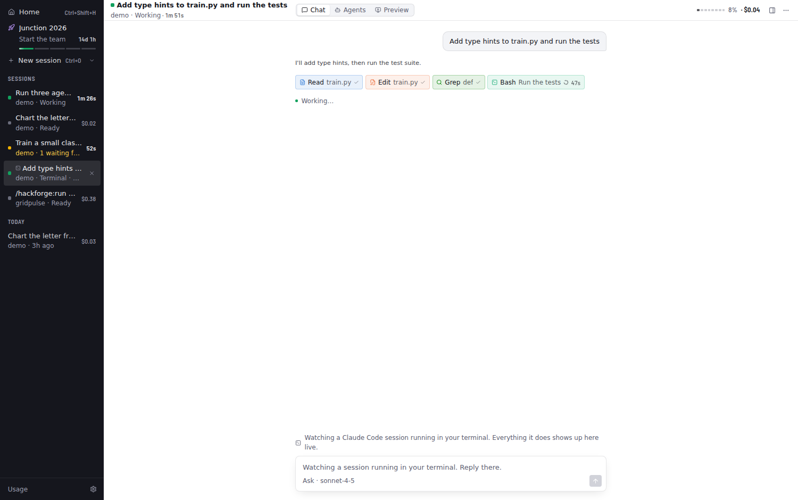

## Preview: Remotion Studio and dev servers

**Preview** (⌘4) embeds what you're building next to the agents building it.

- **Remotion projects** are detected from `package.json`. **Start Studio** runs the project's own Remotion CLI on a free port, with no browser window, and embeds Studio. Studio hot-reloads, so when Claude edits a composition you see the frame change right away. The side panel lists compositions (size, fps, length). **Render** shows live progress through bundling, rendering frames with time left, and encoding, plus Cancel. Finished videos play in the panel, with **Show in Finder**.
- **Dev servers:** `package.json` scripts that start a server (`dev`, `start`, `storybook`, vite/next/astro…) get one-click buttons. Any `localhost` URL that shows up in an agent's command output or in a terminal is offered automatically, and you can type one. Each preview has reload, open in browser, server output and stop.

Remotion downloads its own headless Chrome the first time you render. Set `HARNESS_REMOTION_BROWSER` to use an existing one instead.

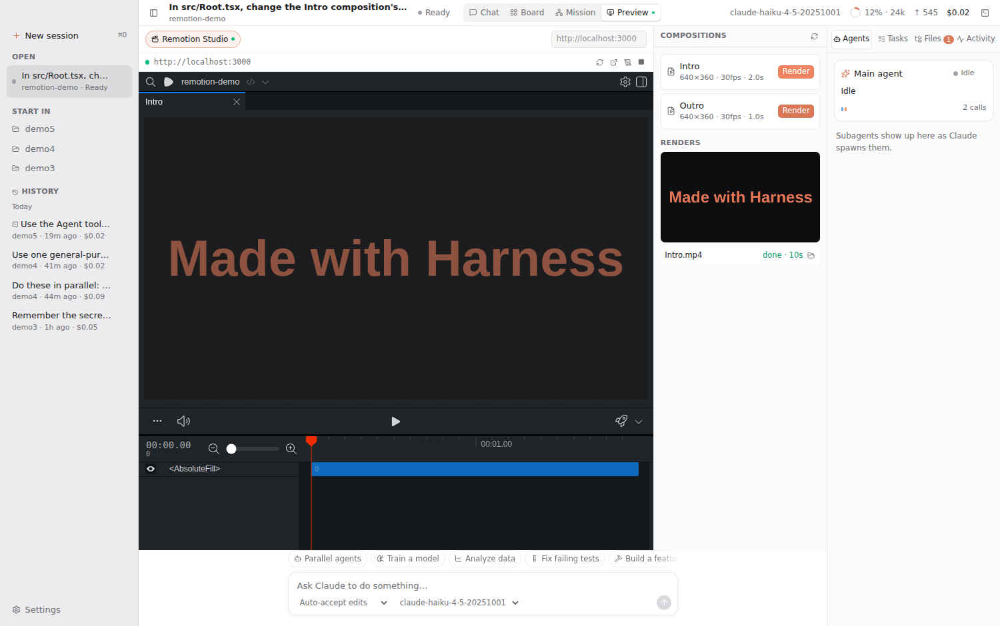

## Action buttons instead of /commands

The buttons above the prompt cover common jobs: parallel agents, train a model, analyze data, fix tests, build a feature, debug, explain, Remotion video and commit. Each opens a form prefilled with example parameters and a preview of the exact prompt. **Commands ▾** lists the session's slash commands and skills, with descriptions and example arguments. Run sends the prompt right away; Edit in prompt drops it into the box so you can change it first.

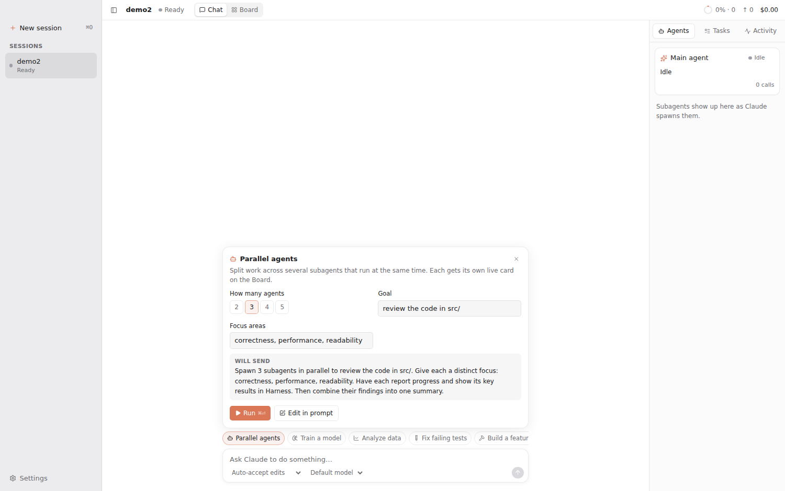

## History and resume

Every session is saved as it runs, in SQLite under `~/Library/Application Support/Harness/harness.db`. The app uses Node's built-in `node:sqlite`, so there's no native module to rebuild. The sidebar's **History** is grouped by day and searchable. Each entry is titled from its first prompt and shows the project, last activity and cost.

Opening a saved session replays its event log through the same reducer as live view, so you see the transcript, tool calls, subagents, charts and task list exactly as they were. **Sending a message, or using an action, resumes it.** The agent restarts with the SDK's `resume`, so Claude has the whole earlier conversation. The task list carries over, and cost keeps adding up. Closing a session (×) stops its agent; it stays in History. The trash icon deletes it.

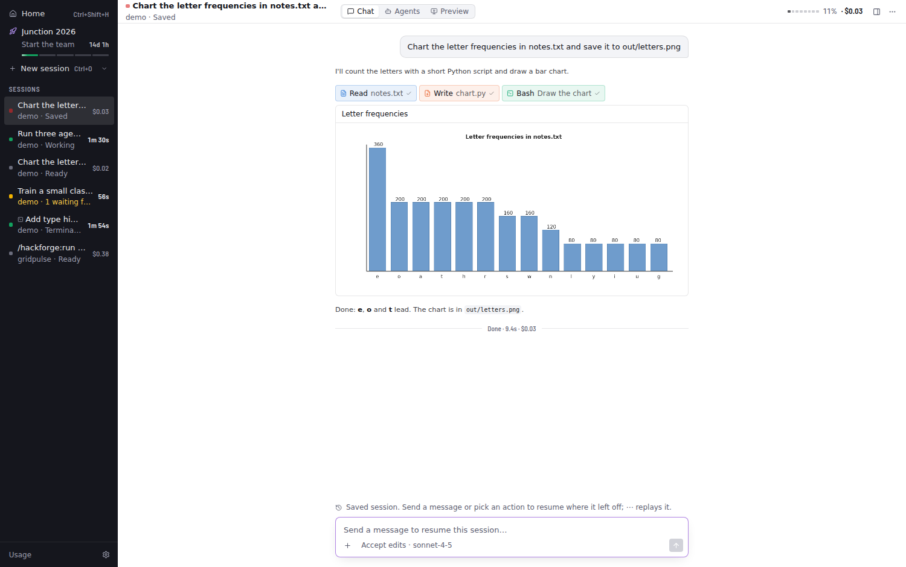

## Status

Phases 1–6 of [the plan](docs/PLAN.md) are done. Phases 1–2:

- **Engine:** Claude Agent SDK with streaming input, so you can queue follow-ups while Claude works. Stop with Esc. Switch model and permission mode mid-session.
- **Live conversation:** streamed markdown, collapsible thinking, and compact tool chips coloured by kind (read, write, search, exec…). Click a chip to see its input, output and diff.
- **Subagents:** each spawned agent gets a live card with its own tool calls, a progress summary and its final report. Background subagents keep running after the turn ends.
- **Permission cards:** Allow (⏎) / Always allow / Deny (⎋), with a diff preview. The dock badge and bounce fire while the app is in the background.
- **Inspector:** a tree of agents (current tool, elapsed time, tokens), the task list (from `TaskCreate`/`TaskUpdate` or `TodoWrite`), and a log of every tool call.
- **Top bar:** context-window gauge, output tokens, session cost, turn timer.
- **Focus mode** (⌘\\), open project (⌘O), settings (⌘,).

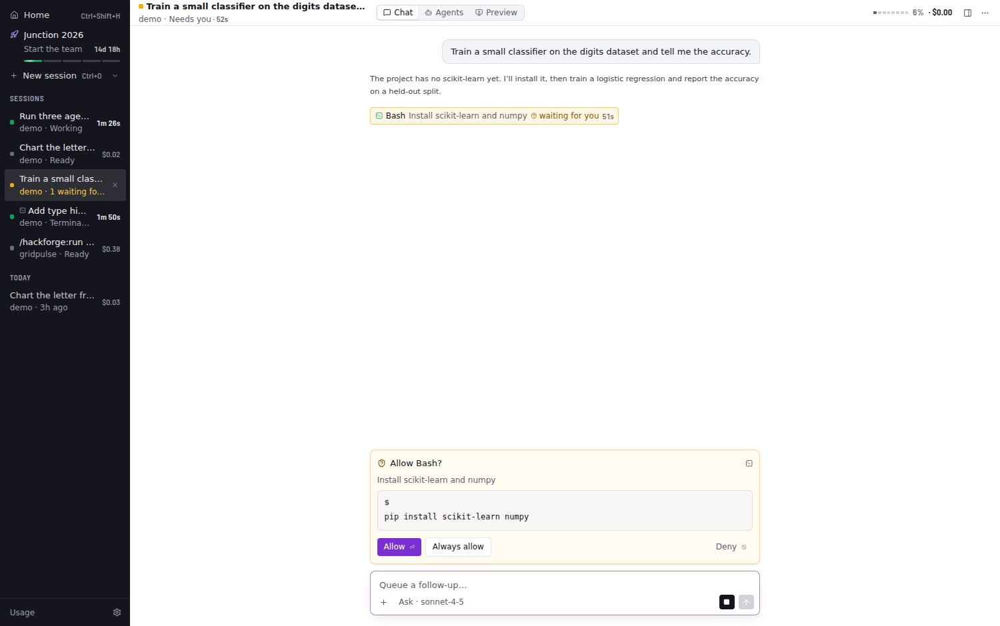

## Run it

```bash
npm install
npm run dev          # launches the app with hot reload
```

Requirements: macOS, Node 20+. Sessions use your existing Claude Code login. You can also store an Anthropic API key under **Settings**; it's encrypted with your macOS Keychain. Sessions load your usual `~/.claude` settings, CLAUDE.md files, MCP servers and skills.

```bash
npm test             # normalizer/reducer tests replay real recorded SDK sessions
npm run typecheck
npm run build:mac    # .dmg in dist/ (unsigned unless you configure a Developer ID)
```

## How it works

```
Claude Agent SDK ──▶ EventNormalizer ──▶ HarnessEvent stream ──▶ IPC (batched ~30fps) ──▶ reducer ──▶ React panels
      ▲                (main process)                                                  (renderer)
      └── canUseTool ◀── PermissionBroker ◀── permission card
```

Everything the UI shows is derived from one typed event stream (`src/shared/events.ts`). Live view now, and history/replay later, run on the same reducer.

| Path | What |
| --- | --- |
| `src/main/agent/AgentService.ts` | One SDK `query()` per session, fed by a push queue; status tracking; interrupt |
| `src/main/agent/permissions.ts` | `canUseTool` ↔ UI round-trip |
| `src/main/store/SessionStore.ts` | SQLite sessions + event log + file snapshots |
| `src/main/project/ChangeTracker.ts` | Pre-edit snapshots, git fallback, diff stats, revert/accept |
| `src/main/project/projectFiles.ts` | Project file listing and recursive watcher |
| `src/main/observe/TranscriptObserver.ts` | Observe mode: transcript tailing → HarnessEvents |
| `src/main/observe/hooks.ts` | Status hook bridge and safe settings.json install/remove |
| `src/main/pty/PtyService.ts` | node-pty terminals streamed to xterm.js |
| `src/main/preview/PreviewService.ts` | Remotion Studio, dev servers, renders, URL detection |
| `src/shared/preview.ts` | Preview types and CLI output parsers |
| `src/renderer/src/features/preview/` | Preview view and Remotion render panel |
| `src/renderer/src/features/mission/` | Agent graph (React Flow) and swim-lane timeline |
| `src/renderer/src/features/files/` | Heat tree, changes list, Monaco diff view |
| `src/main/events/normalizer.ts` | SDK messages → `HarnessEvent`s (tools, subagents, tasks, usage, visuals) |
| `src/main/agent/harnessTools.ts` | The `harness` MCP tools agents use to report progress and show results |
| `src/main/system/telemetry.ts` | Localhost endpoint behind `$HARNESS_URL` for live script telemetry |
| `src/shared/parseOutput.ts` | Progress/metric extraction from command output |
| `src/renderer/src/features/agents/` | Board, agent cards, detail view, "what is it doing now" |
| `src/renderer/src/lib/actions.ts` | Action buttons and their example parameters |
| `src/main/events/bus.ts` | Batches events to the renderer |
| `src/renderer/src/stores/reducer.ts` | Events → session state (pure; unit-tested) |
| `src/renderer/src/features/` | Conversation, agents, tasks, meters |
| `test/fixtures/` | Real SDK sessions recorded for tests |
