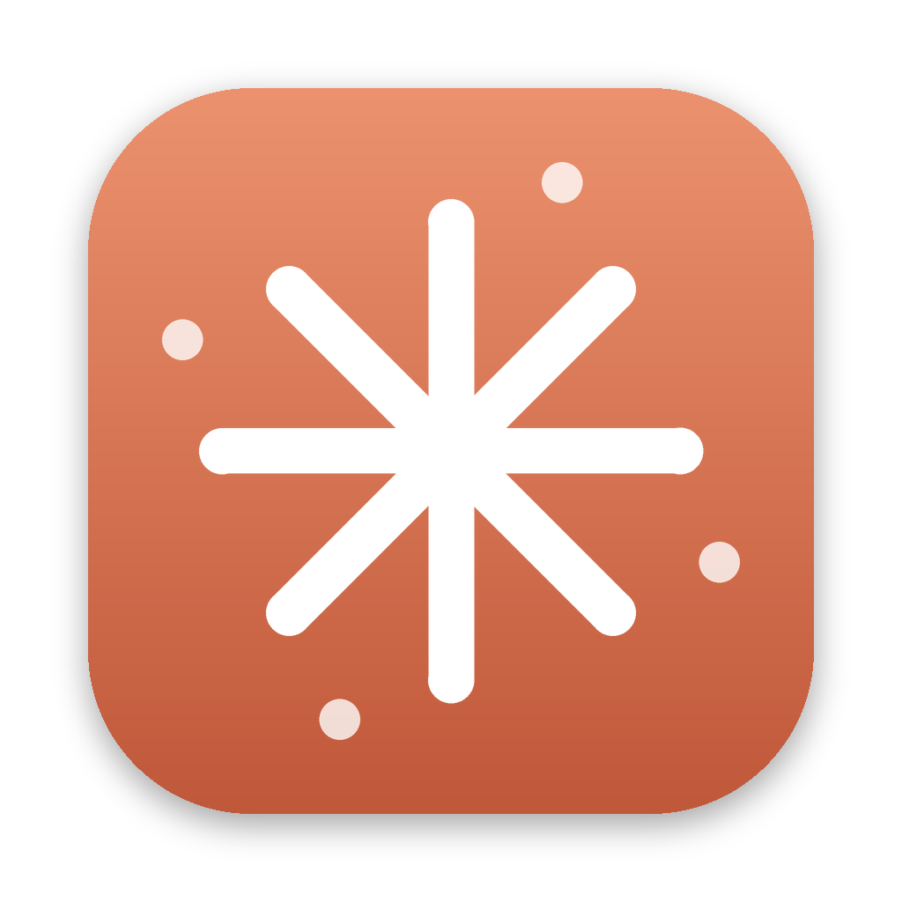
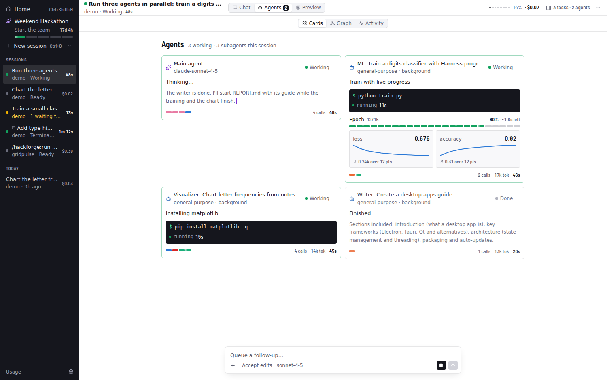
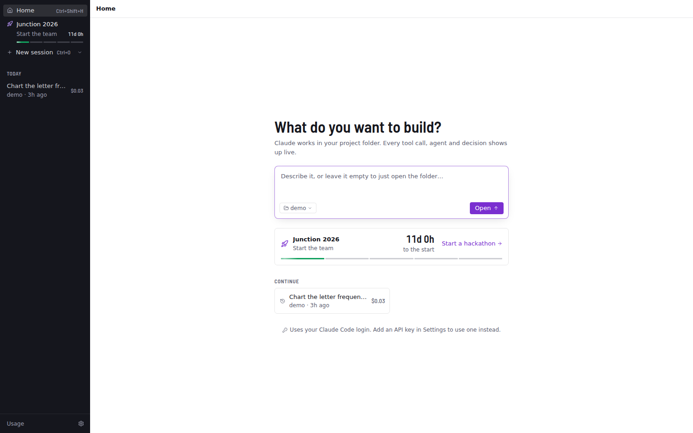
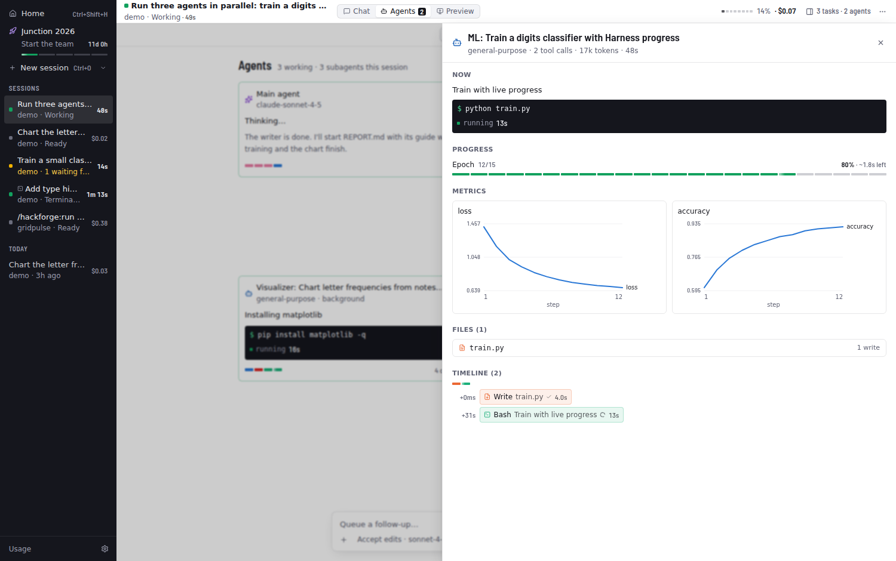
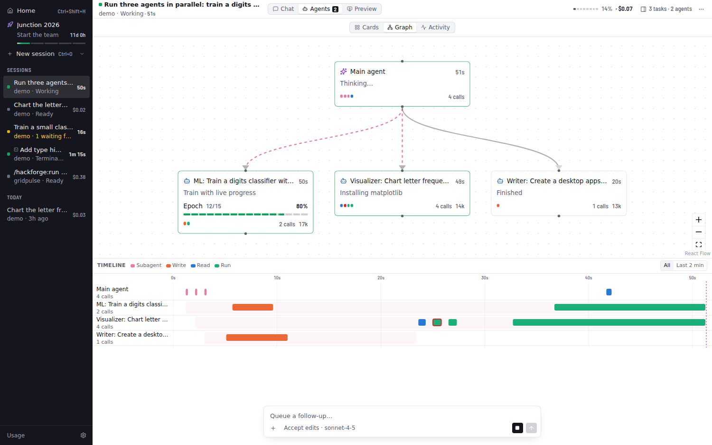
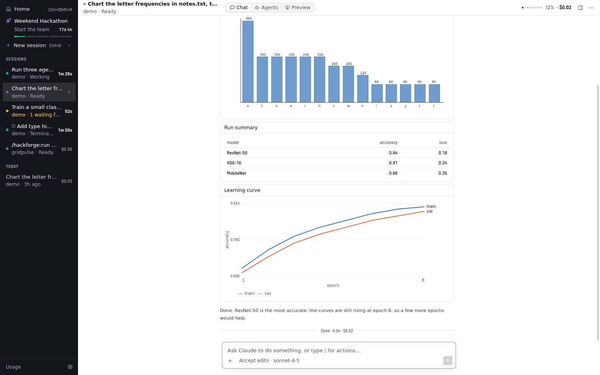
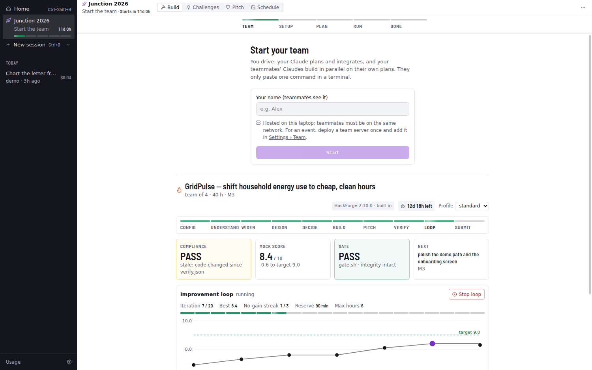

<div align="center">



# Harness

**Watch Claude Code work, live.**
A desktop app that runs Claude Code and shows every agent, tool call, file change and token as it happens.

[](https://github.com/veetin0/ClaudeCodeUI/releases/latest)
[](https://github.com/veetin0/ClaudeCodeUI/actions/workflows/ci.yml)
[](LICENSE)


</div>



Claude Code is powerful, but in a terminal most of what it does scrolls past. Harness puts it on one screen: which agents are running, what each one is doing right now, how far along it is, what it changed, and how much of your plan it's using. You stay in control with one obvious next step on every screen.

## What you get

- **Live agent cards.** Every agent and subagent as a card: the file it's writing, the command it's running, progress bars with an ETA, metric charts and the results it shows.
- **Graph and timeline.** Who spawned whom, and a lane per agent with every tool call on it.
- **Files and diffs.** Every changed file with a side-by-side diff, plus **Revert** and **Accept**.
- **Terminal and observe mode.** Real terminals in the app, and a full live view of Claude Code sessions you started elsewhere.
- **Preview.** Your dev server, Remotion Studio or a 3D model next to the agents building it, with **Click to change** on any element.
- **Usage saver.** Picks Opus or Sonnet per message and compacts between tasks, so your plan limits last longer, with usage history to see where it went.
- **History and replay.** Every session is saved; replay it with a scrubber, or resume it where it stopped.
- **Hackathon mode.** One place for a team to go from an empty laptop to a finished entry. [More below](#hackathon-mode).

<table>
  <tr>
    <td width="50%"></td>
    <td width="50%"></td>
  </tr>
  <tr>
    <td width="50%"></td>
    <td width="50%"></td>
  </tr>
</table>

## Get started

### Download

Get the latest version from **[Releases](https://github.com/veetin0/ClaudeCodeUI/releases/latest)**:

- **macOS** (Apple silicon): the `.dmg`. Open it and drag Harness to Applications.
- **Windows** (x64): `Harness-Setup-….exe`.

You also need [Claude Code](https://docs.claude.com/en/docs/claude-code) installed and logged in (Harness uses your existing login), or an Anthropic API key. On Windows, Claude Code also needs [Git for Windows](https://git-scm.com/download/win); see [docs/WINDOWS.md](docs/WINDOWS.md).

**The first time you open it:** the builds aren't notarized by Apple or signed for Windows yet, so your computer asks once.
- **macOS:** right-click Harness in Applications → **Open** → **Open**. On macOS 15 or newer, try to open it once, then click **Open Anyway** in System Settings › Privacy & Security. If macOS says the app is "damaged", run `xattr -cr /Applications/Harness.app` in Terminal and open it again.
- **Windows:** on the SmartScreen warning, click **More info** → **Run anyway**.

On an Intel Mac, run it from source (below).

### Run it from source

**You need:**
- [Claude Code](https://docs.claude.com/en/docs/claude-code) installed and logged in, or an Anthropic API key
- [Node.js](https://nodejs.org) 22 or newer, and git
- macOS or Windows. On Windows, follow [docs/WINDOWS.md](docs/WINDOWS.md) first

```bash
git clone https://github.com/veetin0/ClaudeCodeUI.git
cd ClaudeCodeUI
npm install
npm run dev
```

Pick a folder, type what you want built, and press Enter.

**Build an app you can install:** `npm run build:mac` (a `.dmg`) or `npm run build:win` (an installer), both in `dist/`. Signing, notarizing and publishing a release are in [docs/RELEASING.md](docs/RELEASING.md). To update a source checkout later: `git pull && npm install`.

Harness loads your usual `~/.claude` settings, `CLAUDE.md` files, MCP servers and skills.

## Hackathon mode



The **Hackathon** place (⌘4) runs a whole hackathon from one laptop: **Team → Setup → Plan → Run → Done**. Teammates lend their Claude with one command (`npx harness-crew …`, no app to install), and Harness hands each of them tasks based on how much plan usage they have left. It also has a challenge board, a partner-API kit, a schedule with checklists, and a pitch-video studio. It's built on [HackForge](docs/HACKFORGE.md), a Claude Code plugin for hackathons that ships inside Harness.

It works for any event: a generic *Weekend Hackathon* example is built in (its dates always lie a couple of weeks ahead), and your own event is one `event.yaml` away. Read the full guide in [docs/HACKATHON.md](docs/HACKATHON.md).

## Privacy

Harness is a local app. There is no account, no telemetry, no analytics and no auto-update phoning home.

- **Your sessions** are saved in a SQLite database on your computer, and Claude Code talks to Anthropic exactly as it does in the terminal.
- **Keys you save in Settings** (Anthropic, ElevenLabs, Context7) are encrypted with the system keychain (macOS Keychain or Windows DPAPI). Partner API keys are stored the same way and also written to your event project's `.env`, which Harness adds to `.gitignore`, so your code can use them.
- **Network calls Harness makes itself:**
  - **Library docs** is on by default: Claude's documentation lookups go to Context7. Turn it off in Settings › Tools.
  - **impeccable's design detector** downloads its engine once from its GitHub releases. Other tools download only when you switch them on (Chromium for the browser, REA, the 3D kit, Remotion's renderer).
  - **Partner key checks** and **ElevenLabs narration** run only when you add a key or press the button.
  - **Phone alerts** (ntfy) are off until you turn them on, and never contain code or keys.
- **Team mode** runs only if you start a team, through a [team server](relay/README.md) you host yourself (your laptop or your own deploy). Shared keys, code bundles and crew missions are encrypted with the team's key before they leave your laptop. The server does see the team's status: names, what each person is working on, session titles, plan usage and which files are changing.

## Learn more

| | |
|---|---|
| [Features](docs/FEATURES.md) | The three places, shortcuts, agents, graph and timeline, files and diffs, terminal, Preview, the / menu, history |
| [Usage saver](docs/USAGE.md) | How Harness stretches your Claude plan, and the usage history |
| [Hackathon mode](docs/HACKATHON.md) | Team run, team board, crew mode, challenges, partner APIs, pitch studio |
| [HackForge](docs/HACKFORGE.md) | The built-in hackathon plugin and its dashboard |
| [Design skills and dev tools](docs/TOOLS.md) | impeccable, UI/UX Pro Max, the browser, library docs, reverse engineering, Blender |
| [Windows](docs/WINDOWS.md) · [Releasing](docs/RELEASING.md) | Setup on Windows; building, signing and notarizing |

## Contributing

Issues and pull requests are very welcome. Bug reports, ideas and small docs fixes all help. Start with [CONTRIBUTING.md](CONTRIBUTING.md) for setup, tests and how the code fits together. Please follow the [Code of Conduct](CODE_OF_CONDUCT.md), and report security problems privately as described in [SECURITY.md](SECURITY.md).

## License

[MIT](LICENSE) © 2026 Veeti Nurmikoski. Bundled third-party work keeps its own license; see [THIRD_PARTY_NOTICES.md](THIRD_PARTY_NOTICES.md).

Harness is an independent project and is not affiliated with or endorsed by Anthropic. Claude and Claude Code are trademarks of Anthropic.
