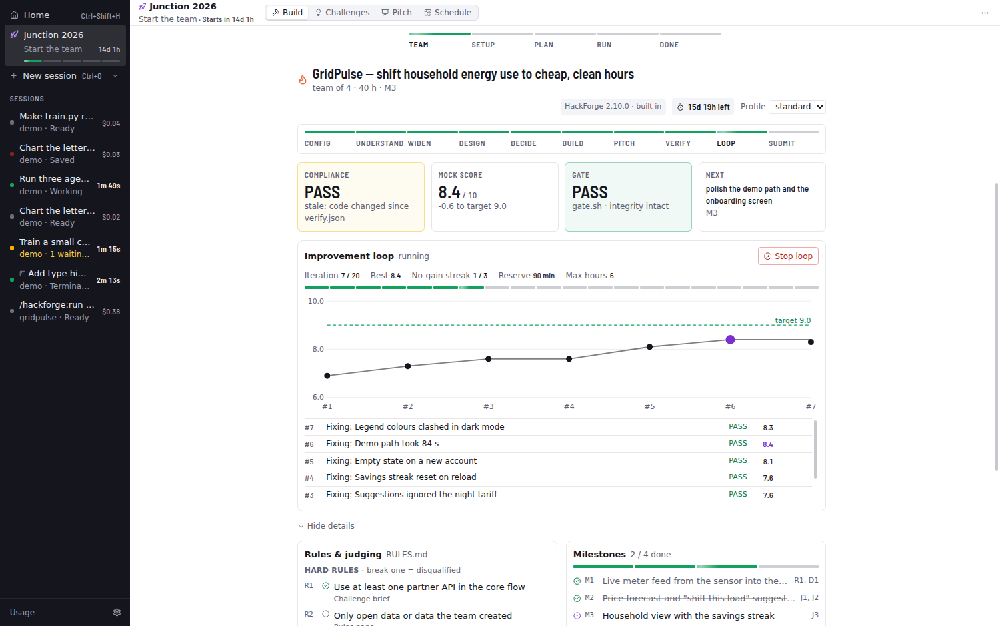
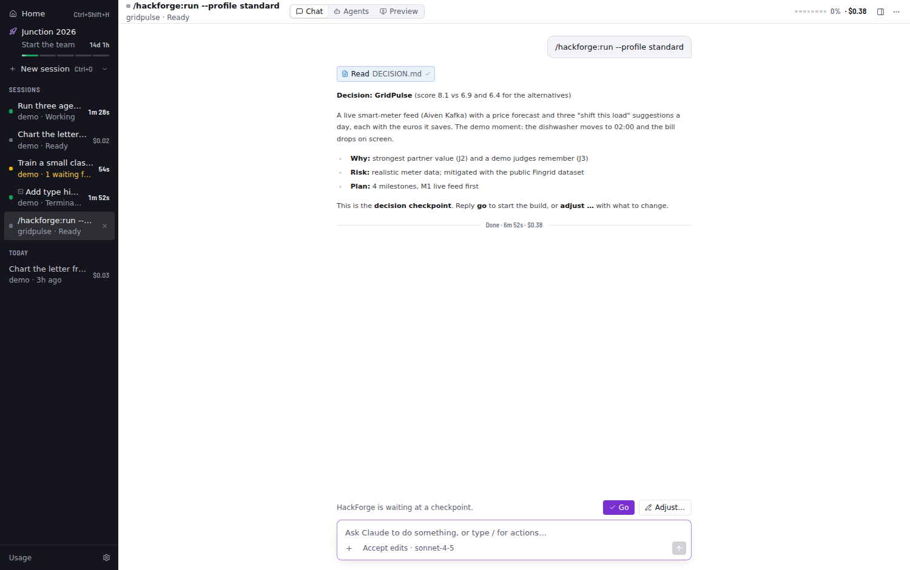
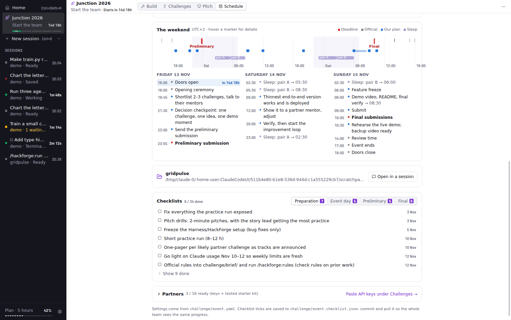
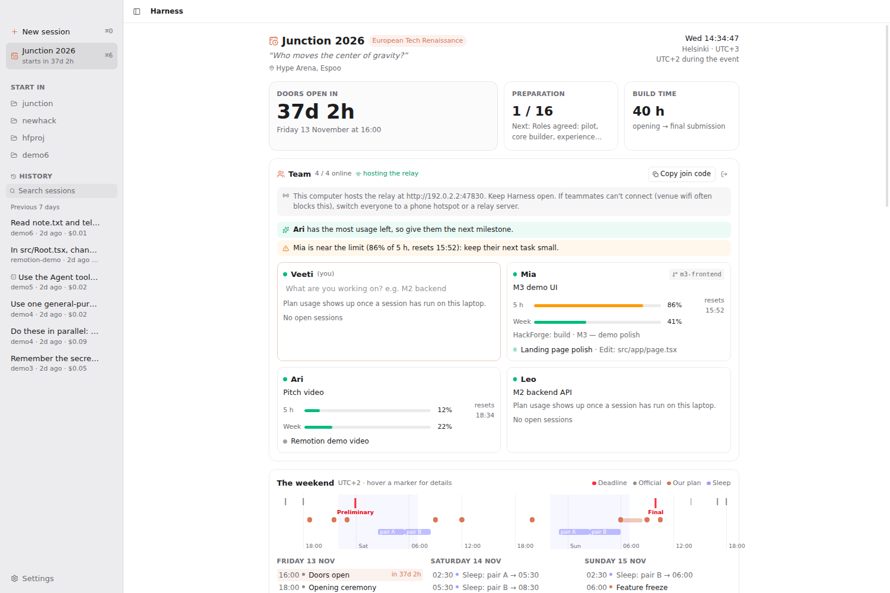
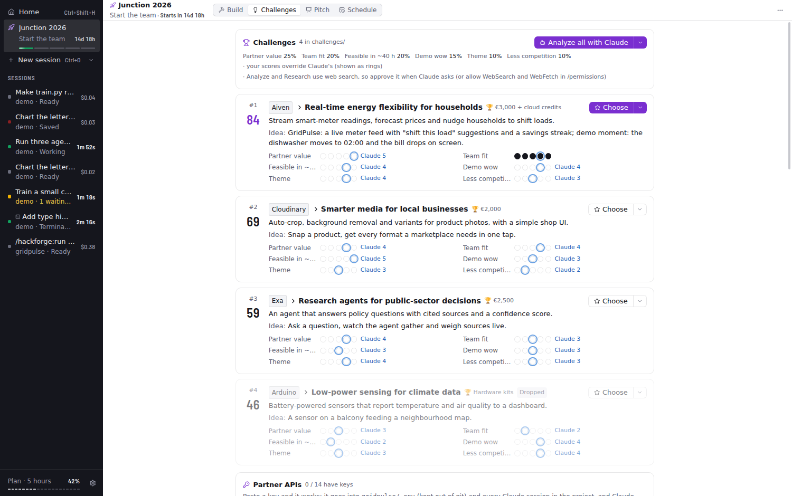
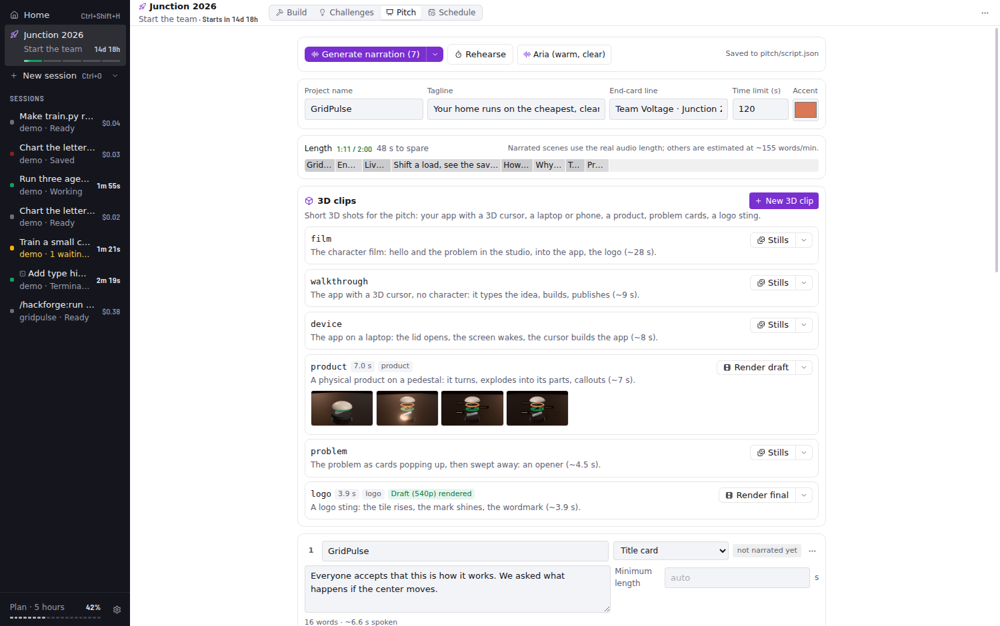
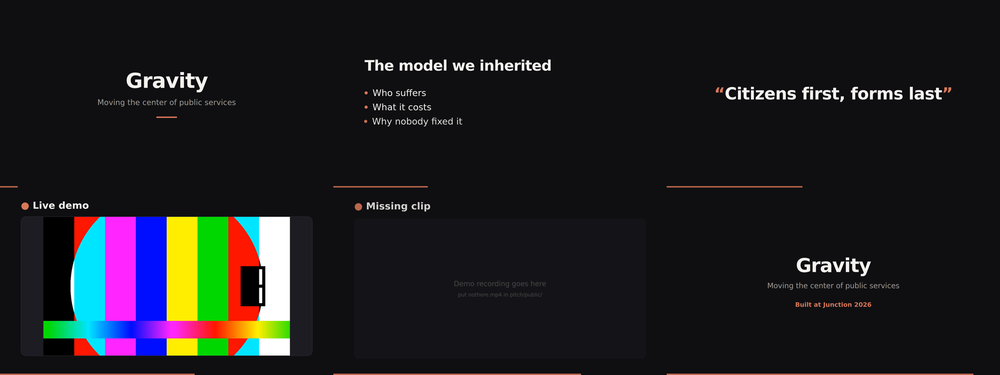
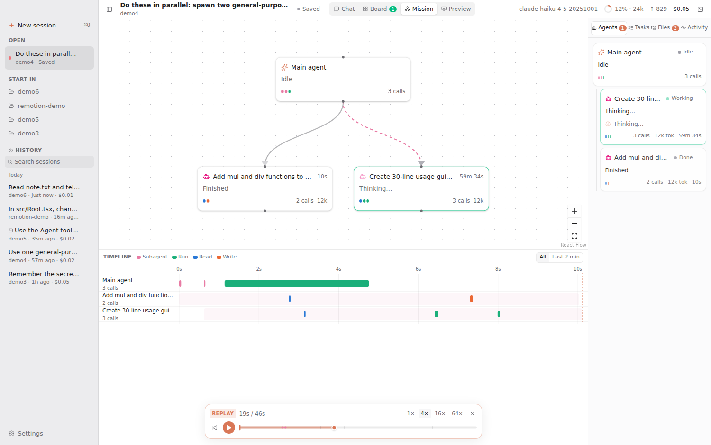

# Harness

A Mac app that runs Claude Code and shows what it's doing as it happens: streamed replies, every tool call, subagents, the task list, context usage and cost.


## Watching agents work

**Board** (⌘2) shows every agent as a live card. Each card shows:

- **What it's doing now:** the file it's writing streams in, a running command shows its line and timer, a search shows its query.
- **Progress bars** with an ETA, and **metric charts** (loss, accuracy, …).
- **The latest result it showed:** an image, chart, table or note.
- **A strip of its tool calls**, coloured by kind.

Click a card for the full detail view: progress, one chart per metric, all results, the files it touched (click to see the diff), its whole timeline and its report.


Agents feed these visuals three ways:

1. **`harness` tools.** Every agent has in-process MCP tools: `status`, `progress`, `metric` and `show`. `show` takes an image path, markdown, a table or a chart. Claude calls them between steps.
2. **`$HARNESS_URL`.** Scripts the agent runs can POST JSON there while they execute, so a training loop updates its progress bar and charts in real time. The format matches the tools, e.g. `{"kind": "progress", "label": "epoch", "current": 3, "total": 10, "metrics": {"loss": 0.42}}`.
3. **Command output.** tqdm bars, `Epoch 3/10` and `loss=0.42`-style lines are parsed automatically.


## Mission control, files and diffs

**Mission** (⌘3) puts two views together. On top is a live **agent graph**: the main agent and every subagent it spawns, nested by who spawned whom. Edges animate while an agent works, and each node shows its current activity, progress and recent tool calls. Below is a **timeline** with one lane per agent and a bar per tool call (colour = kind, length = duration). Parallel calls stack, and a shaded band shows each subagent's lifetime. Hover a bar for details, click it to open that call in its agent's detail view, and switch between All and Last 2 min.


The **Files** tab in the inspector has two parts:

- **Changes:** every file that differs from how it was before the session, with +/− counts.
- **Project tree:** a heat map where files glow blue when read, orange when written, and green when a command changed them, fading over about a minute. Folders containing touched files open automatically. Dots record what ever happened to each file.

Click a changed file for a **Monaco diff** (side by side or inline, unchanged regions folded). Step through files with the arrows, **Revert** to restore the original, or **Accept** to mark it reviewed.

How the "before" is known: the SDK's `PreToolUse` hook snapshots each file just before an agent edits it. Files changed by commands fall back to git's `HEAD` version. Snapshots are saved with the session, so diffs and reverts still work after a restart or from History.


## Terminal and observe mode

**Terminal** (⌘J, or the terminal icon in the top bar) is a panel of real terminals built on node-pty and xterm.js. They open in the session's project and use your login shell, so your PATH, aliases and tools work. Tabs keep their scrollback while hidden. **✳ Claude** opens the interactive Claude Code CLI in a tab.


**Observe mode** shows Claude Code sessions you start outside Harness (iTerm, Terminal, an editor, `claude -p` in a script) in the sidebar with a terminal icon. You get the full live UI for them: conversation, Board, Mission graph and timeline, files and cost. It needs no setup. Harness watches the transcripts Claude Code writes to `~/.claude/projects/`, attributes subagent work through each subagent's metadata file, and saves the session to History so you can resume it later. Sessions Harness runs itself, and other Agent SDK apps, are skipped.

For instant "needs approval", "done" and "ended" status, **Settings → Install hooks** adds a tiny `curl` hook for four events to `~/.claude/settings.json`. The file is backed up first, existing hooks are kept, and **Remove hooks** takes out only Harness's entries. The hook never blocks or fails Claude Code (`curl -m 1 … || true`).


## Preview: Remotion Studio and dev servers

**Preview** (⌘4) embeds what you're building next to the agents building it.

- **Remotion projects** are detected from `package.json`. **Start Studio** runs the project's own Remotion CLI on a free port, with no browser window, and embeds Studio. Studio hot-reloads, so when Claude edits a composition you see the frame change right away. The side panel lists compositions (size, fps, length). **Render** shows live progress through bundling, rendering frames with time left, and encoding, plus Cancel. Finished videos play in the panel, with **Show in Finder**.
- **Dev servers:** `package.json` scripts that start a server (`dev`, `start`, `storybook`, vite/next/astro…) get one-click buttons. Any `localhost` URL that shows up in an agent's command output or in a terminal is offered automatically, and you can type one. Each preview has reload, open in browser, server output and stop.

Remotion downloads its own headless Chrome the first time you render. Set `HARNESS_REMOTION_BROWSER` to use an existing one instead.


## HackForge

Harness is built to drive **HackForge**, the Claude Code plugin for hackathons and coding challenges. **HackForge is built in:** Harness ships a copy in `resources/hackforge` (currently 2.1.1) and loads it into every session through the Agent SDK, so there's nothing to install. If you've also installed HackForge yourself (`claude plugin install hackforge@veeti-tools`) and that copy is newer, Harness uses yours instead. It never loads both. The dashboard shows which one is in use.

To update the built-in copy from your HackForge repository:

```bash
npm run hackforge:sync -- ~/Desktop/hackforge-marketplace   # then rebuild Harness
```

HackForge's hooks run Python 3 (macOS has it with the Xcode command-line tools; Windows: see docs/WINDOWS.md).

- **Automatic in HackForge projects.** When a project has `challenge/` or `.hackforge/`, every session gets instructions to work through the `/hackforge:*` skills and keep `.hackforge/` current. **Settings → HackForge** switches this to *always* (suggest HackForge in every session) or *off*.
- **Buttons for every command:**
  - **Getting started:** Help (the one next step), Init.
  - **Running it:** Run (with a profile picker that writes `profile:` to `challenge/hackforge.yaml`, including `lean` for Pro plans), Kickoff, Build.
  - **Checking and improving:** Verify (quick, full or final), Perfect (target, max iterations, `--hours`…).
  - **Pitch and assets:** Pitch, Video, Craft, Eval.
  - **Coordination and wrap-up:** Team (join, who, claim, handoff, driver), Focus, Rules, Views, Status, Retro.

  Before kickoff only the setup commands show.
- **HackForge dashboard** (⌘5, or the HackForge tab, which shows the loop iteration or the latest mock score). It reads `.hackforge/` live as the agents write it:
  - the phase stepper (config → submit) and a deadline countdown
  - COMPLIANCE, flagged *stale* when code changed after the last verify, as the loop gate would; MOCK_SCORE against the target; whether it was a quick or full verify; the gate result and the integrity lock; and the next action. It reads `verify.json` (HackForge 2.x) or `VERIFY.md` (1.x).
  - the fix order with each finding's severity, the blind judge's first impression, and claims nobody could check yet
  - the improvement loop: iteration / max, best score, the no-gain streak against the plateau limit, a score chart with the target line, every iteration (from `ledger.jsonl` and `LOOP.md`) kept or reverted, and the advisor's decisions when the loop gets stuck
  - buttons for HackForge's HTML decision pages (`/hackforge:views`)
  - **Stop loop**, which creates `.hackforge/STOP_LOOP`
  - hard rules and deliverables with their compliance checks, judging criteria with weights and per-criterion mock scores, milestones, the fix order, team directives and the decision
- **Checkpoints:** when HackForge stops for "go / adjust", **Go** and **Adjust…** buttons appear above the prompt. Questions Claude asks with AskUserQuestion appear as a card with option buttons and a free-text answer.
- HackForge's subagents show up by role (Rules Lawyer, Judge, Builder…) on the Board and in the graph.
- A hint suggests **Accept edits** while the loop runs, because every permission prompt pauses it.
- The pitch studio's **3D / animated clips** button runs `/hackforge:video`, which adds clips to `pitch/public/` as screen scenes.





## Event mode (hackathon war room)

**⌘6**, the event entry in the sidebar, or the card on the start screen opens event mode. Event mode is reusable: everything comes from an `event.yaml`. **Junction 2026** (Espoo, 13–15 Nov) ships as the built-in preset.

- **Clock:** a countdown to the doors opening, then to the next deadline (amber 3 h before, red in the last hour), the next step of the plan, and who is asleep right now. Times are shown in the event's time zone. Junction's are Helsinki local time, so the switch to winter time (UTC+2) on Oct 25 is already accounted for.
- **The weekend:** one timeline with official times, the two submission deadlines, our plan and the sleep shifts, plus an agenda per day. It covers about 40 h of build time: preliminary submission Fri 23:55, final Sun 10:00.
- **Event project:** one click sets up a folder (or an existing repo) for the event:
  - `challenge/event.yaml` (schedule, partners, checklists; edit it freely)
  - an event brief and a strategy directive that HackForge reads
  - HackForge settings for the event: 40 h, team of 4, the real deadline, the loop stopping 4 h before it, cheaper models for builders and stronger ones for the architect and judges
- **Checklists:** preparation (week by week up to the event), event-day logistics, the preliminary submission and the final submission. Each has a due time, and overdue items turn red.
- **Partners board:** all 16 Junction partners by category, each with *Keys* (account and API key ready) and *Kit* (starter kit tested) toggles.
- Ticks are saved to `challenge/event-checklist.json`. Commit it, and the team shares one checklist through git.



### Team board

Event mode's **Team** panel shows all four laptops in one place. Each teammate keeps using their own Claude login, and their Harness shares a small status through a relay:
- what they're working on and their git branch
- their open sessions, with what the agent is doing right now
- their HackForge phase and score
- **how much of their Claude plan is left** (5-hour and weekly windows, with reset times)

Harness suggests who should take the next milestone (the person with the most usage left) and warns when someone is close to or at a limit. Your own 5-hour usage also shows in the top bar.

- **Create the team** by hosting the relay on one laptop (same network, good for practice), or point it at a relay server. For the venue, [`relay/`](relay/README.md) is one dependency-free Node file plus a Dockerfile, deployable to any host with HTTPS.
- **Join** with the join code from **Copy join code**.
- Plan usage comes from what Claude Code reports while a session runs, so a teammate's numbers appear after their first session. With an API key set in Settings, the board shows "API key" instead.



### Challenge board

The **Challenges** tab in event mode. At the opening ceremony, use **Paste all** with the challenge page's text, and Claude splits it into one file per challenge in `challenges/` (outside `challenge/`, so HackForge only ever reads the one you pick).

- **Analyze all with Claude** researches each partner and adds a summary, an idea with its demo moment, the partner technology it would run on, risks, and scores for six weighted criteria: partner value 25 %, team fit 20 %, feasible in ~40 h 20 %, demo wow 15 %, theme 10 %, less competition 10 %.
- Click the dots to give your own scores. They override Claude's, which show as rings.
- Each challenge has mentor notes, plus **Research partner**, **Shortlist** and **Drop**.
- **Choose** writes `challenge/brief/00-chosen-challenge.md` (description, mentor notes, starting idea) for HackForge, names the challenge in `hackforge.yaml`, and ticks "Challenge chosen" on the preliminary checklist.

Prompts sent from event mode go to a Claude session in the event project while you stay on the board. If Claude needs approval (e.g. for web search), the notice turns amber.



### Pitch studio

The **Pitch** tab creates `pitch/`, a Remotion video driven by `pitch/script.json`:
- **Scenes:** title, bullet points, big statement, demo clip or screenshot, and end card, with a progress bar.
- **Starter script:** the stage arc (the inherited model → our flip → live demo → how it works → why it matters).

- **Write script with Claude** writes the script from `.hackforge/` (decision, plan, demo, verify) to fit the time limit.
- **Narration with ElevenLabs:** pick a voice, then **Generate narration**. Only scenes whose text or voice changed are regenerated (files are content-hashed, so there are no repeat charges), and the video times each scene to its real audio length.
- **Editor:** the length is shown against the time limit; edits save to `script.json` automatically.
- **Rehearse:** a full-screen teleprompter with the video's timing, per-scene countdowns and the overall clock.
- **Preview & render:** opens Remotion Studio and Render on the Preview tab. The output is `pitch/out/pitch.mp4`.

The ElevenLabs key is stored in the Keychain, or read from `ELEVENLABS_API_KEY`.





## Everyday polish

- **Native menu** with every command and its shortcut. It also makes ⌘C/⌘V/⌘Z work everywhere.
- **⌘K command palette:** commands, views, open sessions, History, projects, and the "Ask Claude" actions.
- **Notifications:** when Claude needs approval, or finishes a turn longer than 15 s, while Harness is in the background or you're looking at another session. Clicking a notification jumps to the session. You can turn them off in Settings.
- **Menu-bar item:** shows how many sessions are working (and `!` when one needs you), and lists them. The dock badge counts sessions waiting for approval.
- **Replay** (⇧⌘R, or Replay in a saved session's banner): a scrubber over the session's saved events, with play at 1×, 4×, 16× or 64×. Ticks mark prompts, finished turns and subagent launches. Every view (chat, Board, Mission graph and timeline, files, meters) shows the session as it was at the playhead.



## Action buttons instead of /commands

The buttons above the prompt (with a HackForge row in HackForge projects) cover common jobs: parallel agents, train a model, analyze data, fix tests, build a feature, debug, explain, Remotion video and commit. Each opens a form prefilled with example parameters and a preview of the exact prompt. **Commands ▾** lists the session's slash commands and skills, with descriptions and example arguments. Run sends the prompt right away; Edit in prompt drops it into the box so you can change it first.


## History and resume

Every session is saved as it runs, in SQLite under `~/Library/Application Support/Harness/harness.db`. The app uses Node's built-in `node:sqlite`, so there's no native module to rebuild. The sidebar's **History** is grouped by day and searchable. Each entry is titled from its first prompt and shows the project, last activity and cost.

Opening a saved session replays its event log through the same reducer as live view, so you see the transcript, tool calls, subagents, charts and task list exactly as they were. **Sending a message, or using an action, resumes it.** The agent restarts with the SDK's `resume`, so Claude has the whole earlier conversation. The task list carries over, and cost keeps adding up. Closing a session (×) stops its agent; it stays in History. The trash icon deletes it.


## Status

All seven phases of [the plan](docs/PLAN.md) are done. Phases 1–2:

- **Engine:** Claude Agent SDK with streaming input, so you can queue follow-ups while Claude works. Stop with Esc. Switch model and permission mode mid-session.
- **Live conversation:** streamed markdown, collapsible thinking, and compact tool chips coloured by kind (read, write, search, exec…). Click a chip to see its input, output and diff.
- **Subagents:** each spawned agent gets a live card with its own tool calls, a progress summary and its final report. Background subagents keep running after the turn ends.
- **Permission cards:** Allow (⏎) / Always allow / Deny (⎋), with a diff preview. The dock badge and bounce fire while the app is in the background.
- **Inspector:** a tree of agents (current tool, elapsed time, tokens), the task list (from `TaskCreate`/`TaskUpdate` or `TodoWrite`), and a log of every tool call.
- **Top bar:** context-window gauge, output tokens, session cost, turn timer.
- **Focus mode** (⌘\\), open project (⌘O), settings (⌘,).


## Run it

```bash
npm install
npm run dev          # launches the app with hot reload
```

Requirements: macOS or Windows, Node 20+. On Windows you also need Git for Windows and Python 3 (for HackForge); see **[docs/WINDOWS.md](docs/WINDOWS.md)** for setup, the Windows installer, and a small patch that makes the HackForge plugin work there. Mixed Mac and Windows teams share one event project.

Sessions use your existing Claude Code login. You can also store an Anthropic API key under **Settings**; it's encrypted with the system keychain (Keychain on macOS, DPAPI on Windows). Sessions load your usual `~/.claude` settings, CLAUDE.md files, MCP servers and skills.

```bash
npm test             # normalizer/reducer tests replay real recorded SDK sessions
npm run typecheck
npm run build:mac    # unsigned .dmg for you and your team
npm run release:mac  # signed + notarized .dmg with a Developer ID; see docs/RELEASING.md
npm run build:win    # Windows installer (run on Windows): dist\Harness-Setup-<version>.exe
npm run build:dir    # unpacked app for a quick packaging smoke test
```

## How it works

```
Claude Agent SDK ──▶ EventNormalizer ──▶ HarnessEvent stream ──▶ IPC (batched ~30fps) ──▶ reducer ──▶ React panels
      ▲                (main process)                                                  (renderer)
      └── canUseTool ◀── PermissionBroker ◀── permission card
```

Everything the UI shows is derived from one typed event stream (`src/shared/events.ts`). Live view now, and history/replay later, run on the same reducer.

| Path | What |
| --- | --- |
| `src/main/agent/AgentService.ts` | One SDK `query()` per session, fed by a push queue; status tracking; interrupt |
| `src/main/agent/permissions.ts` | `canUseTool` ↔ UI round-trip |
| `src/main/store/SessionStore.ts` | SQLite sessions + event log + file snapshots |
| `src/main/project/ChangeTracker.ts` | Pre-edit snapshots, git fallback, diff stats, revert/accept |
| `src/main/project/projectFiles.ts` | Project file listing and recursive watcher |
| `src/main/observe/TranscriptObserver.ts` | Observe mode: transcript tailing → HarnessEvents |
| `src/main/observe/hooks.ts` | Status hook bridge and safe settings.json install/remove |
| `src/main/pty/PtyService.ts` | node-pty terminals streamed to xterm.js |
| `src/main/preview/PreviewService.ts` | Remotion Studio, dev servers, renders, URL detection |
| `src/shared/preview.ts` | Preview types and CLI output parsers |
| `src/renderer/src/features/preview/` | Preview view and Remotion render panel |
| `src/renderer/src/features/mission/` | Agent graph (React Flow) and swim-lane timeline |
| `src/renderer/src/features/files/` | Heat tree, changes list, Monaco diff view |
| `src/main/events/normalizer.ts` | SDK messages → `HarnessEvent`s (tools, subagents, tasks, usage, visuals) |
| `src/main/agent/harnessTools.ts` | The `harness` MCP tools agents use to report progress and show results |
| `src/main/system/telemetry.ts` | Localhost endpoint behind `$HARNESS_URL` for live script telemetry |
| `src/shared/parseOutput.ts` | Progress/metric extraction from command output |
| `src/renderer/src/features/agents/` | Board, agent cards, detail view, "what is it doing now" |
| `src/renderer/src/lib/actions.ts` | Action buttons and their example parameters |
| `src/main/events/bus.ts` | Batches events to the renderer |
| `src/renderer/src/stores/reducer.ts` | Events → session state (pure; unit-tested) |
| `src/renderer/src/features/` | Conversation, agents, tasks, meters |
| `test/fixtures/` | Real SDK sessions recorded for tests |
