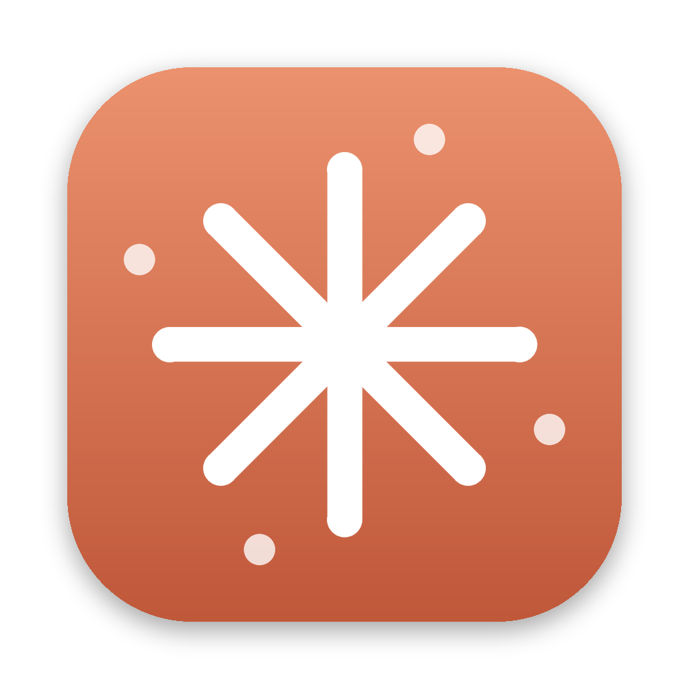
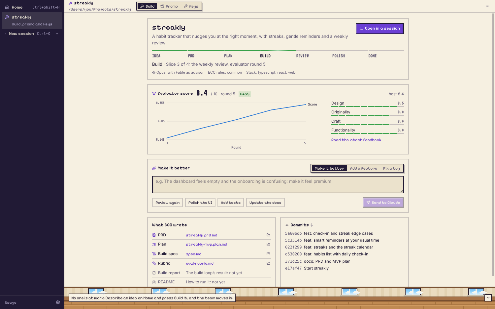
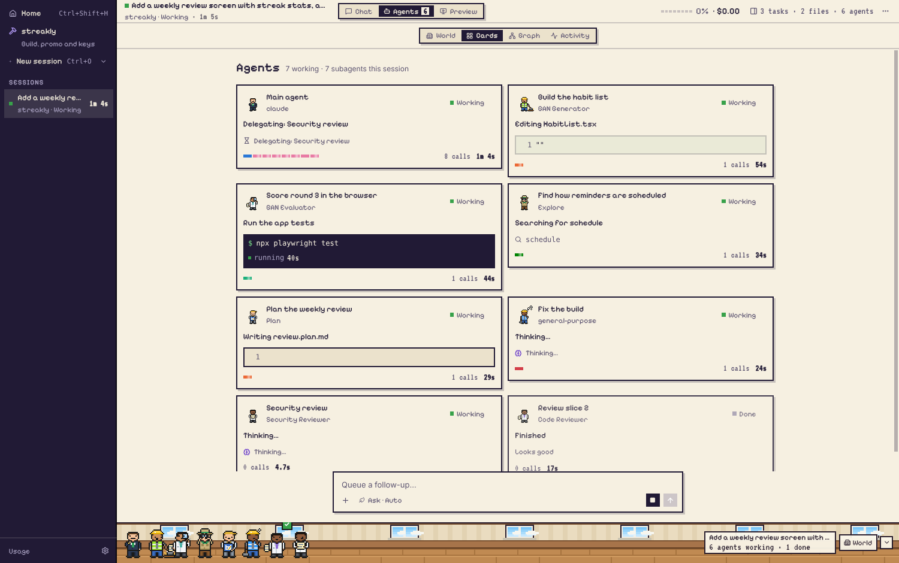
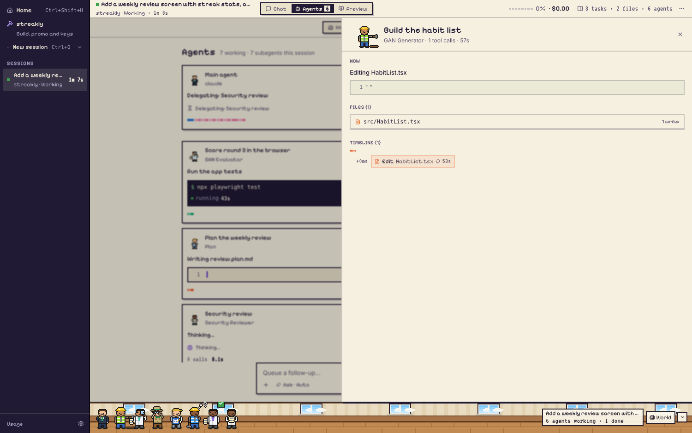
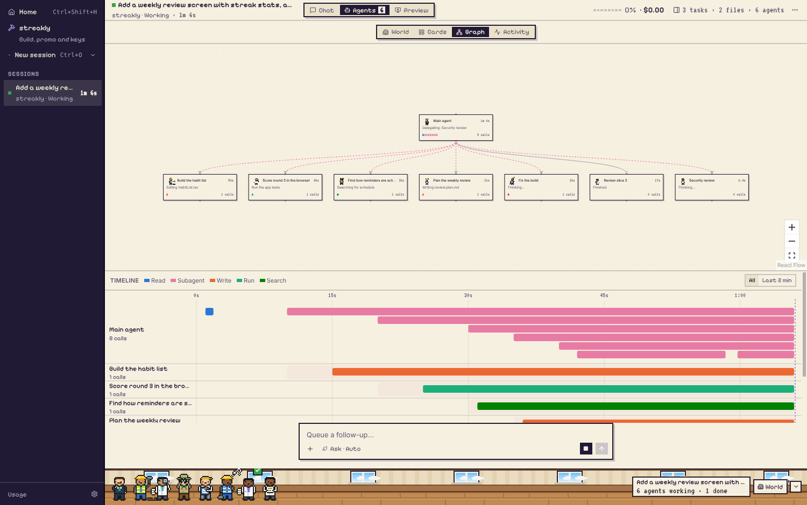
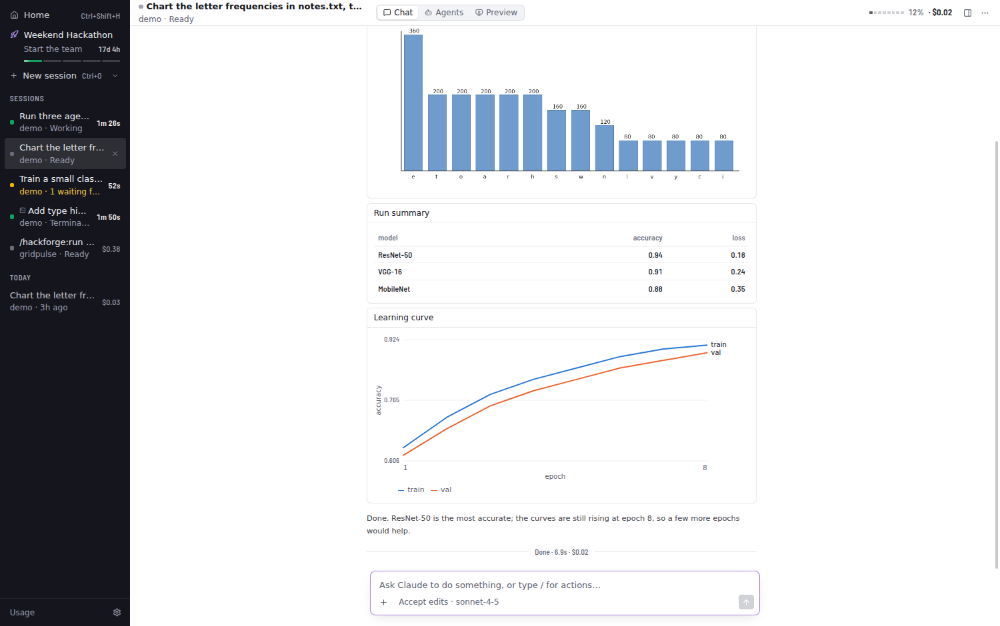
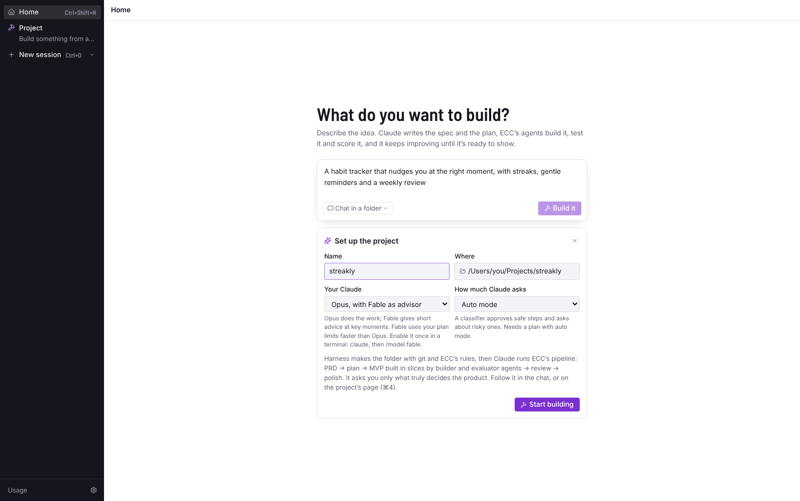

<div align="center">



# Harness

**One idea in. A built, tested, polished product out.**
A desktop app where Claude plans your project, a team of agents builds and scores it, and you watch every step and make it better.

[](https://github.com/veetin0/ClaudeCodeUI/releases/latest)
[](https://github.com/veetin0/ClaudeCodeUI/actions/workflows/ci.yml)
[](LICENSE)


</div>



Describe what you want to build and press **Build it**. Harness sets up the project, and Claude runs [ECC](https://github.com/affaan-m/ECC)'s pipeline on it:
1. a product spec;
2. a plan;
3. an MVP built in thin slices, each scored in the running app by an evaluator agent until it's good;
4. code and security review;
5. a final design pass.

You see all of it as it happens: every agent, tool call, file change and token. One box asks Claude to make it better, add a feature or fix a bug.

## What you get

- **Build it.** One idea becomes a project: a folder with git and ECC's rules, then a session that goes from PRD to plan to MVP to review to polish, asking you only what truly decides the product. [How it works](docs/PROJECTS.md).
- **The Project place.** The build's stage, the evaluator's score per round, the PRD, plan and commits, and **Make it better**. Its **Promo** tab makes a promo video and a presentation deck; **Keys** holds the project's API keys and adds tools like GitHub, Supabase or Vercel from ECC's catalog.
- **ECC built in.** 72 agents, 327 skills and 98 commands in every session, with hooks that stop risky commands, all one **/** away.
- **The team.** Agents as animated pixel characters: the manager (the main agent) hands out work and points at each new teammate, builders hammer and run and get knocked down when a step fails, scientists check the work, architects draw the plan and explorers scout.
- **Live agent cards.** Every agent and subagent as a card: the file it's writing, the command it's running, progress bars with an ETA, metric charts and the results it shows.
- **Graph and timeline.** Who spawned whom, and a lane per agent with every tool call on it.
- **Files and diffs.** Every changed file with a side-by-side diff, plus **Revert** and **Accept**.
- **Terminal and observe mode.** Real terminals in the app, and a full live view of Claude Code sessions you started elsewhere.
- **Preview.** Your dev server, Remotion Studio or a 3D model next to the agents building it, with **Click to change** on any element.
- **Usage saver.** Picks Opus or Sonnet per message and compacts between tasks, so your plan limits last longer, with usage history to see where it went.
- **History and replay.** Every session is saved; replay it with a scrubber, or resume it where it stopped.

<table>
  <tr>
    <td width="50%"></td>
    <td width="50%"></td>
  </tr>
  <tr>
    <td width="50%"></td>
    <td width="50%"></td>
  </tr>
</table>

## Get started

### Download

Get the latest version from **[Releases](https://github.com/veetin0/ClaudeCodeUI/releases/latest)**:

- **macOS** (Apple silicon): the `.dmg`. Open it and drag Harness to Applications.
- **Windows** (x64): `Harness-Setup-….exe`.

You also need [Claude Code](https://docs.claude.com/en/docs/claude-code) installed and logged in (Harness uses your existing login), or an Anthropic API key. On Windows, Claude Code also needs [Git for Windows](https://git-scm.com/download/win); see [docs/WINDOWS.md](docs/WINDOWS.md).

**The first time you open it:** the builds aren't notarized by Apple or signed for Windows yet, so your computer asks once.
- **macOS:** right-click Harness in Applications → **Open** → **Open**. On macOS 15 or newer, try to open it once, then click **Open Anyway** in System Settings › Privacy & Security. If macOS says the app is "damaged", run `xattr -cr /Applications/Harness.app` in Terminal and open it again.
- **Windows:** on the SmartScreen warning, click **More info** → **Run anyway**.

On an Intel Mac, run it from source (below).

### Run it from source

**You need:**
- [Claude Code](https://docs.claude.com/en/docs/claude-code) installed and logged in, or an Anthropic API key
- [Node.js](https://nodejs.org) 22 or newer, and git
- macOS or Windows. On Windows, follow [docs/WINDOWS.md](docs/WINDOWS.md) first

```bash
git clone https://github.com/veetin0/ClaudeCodeUI.git
cd ClaudeCodeUI
npm install
npm run dev
```

Describe what you want to build and press **Build it**.

**Build an app you can install:** `npm run build:mac` (a `.dmg`) or `npm run build:win` (an installer), both in `dist/`. Signing, notarizing and publishing a release are in [docs/RELEASING.md](docs/RELEASING.md). To update a source checkout later: `git pull && npm install`.

Harness loads your usual `~/.claude` settings, `CLAUDE.md` files, MCP servers and skills.

## From an idea to a product



1. **Describe it** on Home and press **Build it**.
2. **Set up the project:** a name, where it goes, which Claude builds it (Opus with Fable as advisor by default), and how much it asks (auto mode, or a prompt before each command).
3. **Claude builds it** with ECC's pipeline:
   - a PRD, then a plan with a modern stack;
   - an MVP in thin slices, built by a generator agent and scored in the running app by an evaluator agent;
   - code review, security review and verification;
   - a design pass and a README.

   Each slice lands as its own commit.
4. **Follow it** on **Project** (⌘4): the stage, the score per round, what ECC wrote. Then **make it better**, add a feature, fix a bug, or make the promo video.

A real build needs your Claude login and an hour or more of Claude time for a small app. The full guide is in [docs/PROJECTS.md](docs/PROJECTS.md).

## Privacy

Harness is a local app. There is no account, no telemetry, no analytics and no auto-update phoning home.

- **Your sessions** are saved in a SQLite database on your computer, and Claude Code talks to Anthropic exactly as it does in the terminal.
- **Keys you save in Settings** (Anthropic, ElevenLabs, Context7) are encrypted with the system keychain (macOS Keychain or Windows DPAPI). API keys you add to a project are stored the same way and also written to the project's `.env`, which git ignores, so your code can use them. Tools from ECC's catalog get their keys the same way; no key is written into any other project file.
- **Network calls Harness makes itself:**
  - **Library docs** is on by default: Claude's documentation lookups go to Context7. Turn it off in Settings › Tools.
  - **impeccable's design detector** downloads its engine once from its GitHub releases. Other tools download only when you switch them on (Chromium for the browser, REA, the 3D kit, Remotion's renderer, and the cartoon short skill from GitHub when you pick a cartoon promo video).
  - **API key checks** and **ElevenLabs narration** run only when you add a key or press the button. For a key Harness doesn't know, it asks Claude in a new session to work out the service (the key itself never goes into the prompt).
  - **Phone alerts** (ntfy) are off until you turn them on, and never contain code or keys.
- **MCP servers from ECC's catalog** run only when you add them to a project, and talk to their own services.

## Learn more

| | |
|---|---|
| [Projects](docs/PROJECTS.md) | Build it, ECC's pipeline, the Project place (Build, Promo, Keys), ECC in every session |
| [Features](docs/FEATURES.md) | The three places, shortcuts, agents and the team, graph and timeline, files and diffs, terminal, Preview, the / menu, history |
| [Usage saver](docs/USAGE.md) | How Harness stretches your Claude plan, the advisor, and the usage history |
| [Design skills and dev tools](docs/TOOLS.md) | impeccable, UI/UX Pro Max, the browser, library docs, reverse engineering, Blender |
| [Windows](docs/WINDOWS.md) · [Releasing](docs/RELEASING.md) | Setup on Windows; building, signing and notarizing |

## Contributing

Issues and pull requests are very welcome. Bug reports, ideas and small docs fixes all help. Start with [CONTRIBUTING.md](CONTRIBUTING.md) for setup, tests and how the code fits together. Please follow the [Code of Conduct](CODE_OF_CONDUCT.md), and report security problems privately as described in [SECURITY.md](SECURITY.md).

## License

[MIT](LICENSE) © 2026 Veeti Nurmikoski. Bundled third-party work keeps its own license; see [THIRD_PARTY_NOTICES.md](THIRD_PARTY_NOTICES.md).

Harness is an independent project and is not affiliated with or endorsed by Anthropic. Claude and Claude Code are trademarks of Anthropic.
