# Features

Everything Harness does in a session, in one place. For hackathon teams, see [Hackathon mode](HACKATHON.md).

← [Back to the README](../README.md)

## Three places

Harness has three places, and every screen has one main button: the next thing to do.

- **Home** (⇧⌘H): one box, "What do you want to build?", and the folder to work in. Press Enter and Claude starts there. Below it are the hackathon at a glance and up to four sessions to continue.
- **A session** has three views: **Chat**, **Agents** and **Preview** (⌘1–⌘3).
  - Type **/** in the prompt box, or press **+**, for every action and command: the suggested next step, HackForge's commands, quick actions (parallel agents, train a model, fix tests…) and the project's own slash commands. Each one opens a short form showing the exact prompt it will send.
  - In HackForge projects, a **Next:** chip above the box follows the project's phase: Kickoff → Build → Verify → Pitch.
  - The **mode chip** in the box holds the permission mode, the model and the Usage saver.
  - The **status chip** in the top bar holds context, plan usage, tokens and cost.
  - **⋯** holds the terminal, replay, handoff, Click to change and focus mode.
  - The **side panel** (⌘I) shows the task list, changed files, running agents, and HackForge's phase and score.
- **Hackathon** (⌘4): the team run and team board, the challenges, your API keys, the pitch and the HackForge dashboard, all for one project, in three tabs: **Build**, **Challenges** and **Pitch**.

**Usage** (⌘5) and **Settings** (⌘,) open on top of whatever you're doing.
- **Settings** has four tabs: General, Team, Tools and Advanced. Each tool is one switch that sets itself up when you turn it on.
- **⌘K** still finds every command, place, session and action.

| Shortcut | Goes to |
|---|---|
| ⇧⌘H | Home |
| ⌘1 / ⌘2 / ⌘3 | Chat / Agents / Preview |
| ⌘4 | Hackathon |
| ⌘5 | Usage |
| ⌘I | Side panel |
| ⌘J | Terminal |
| ⌘K | Command palette |
| ⌘, | Settings |

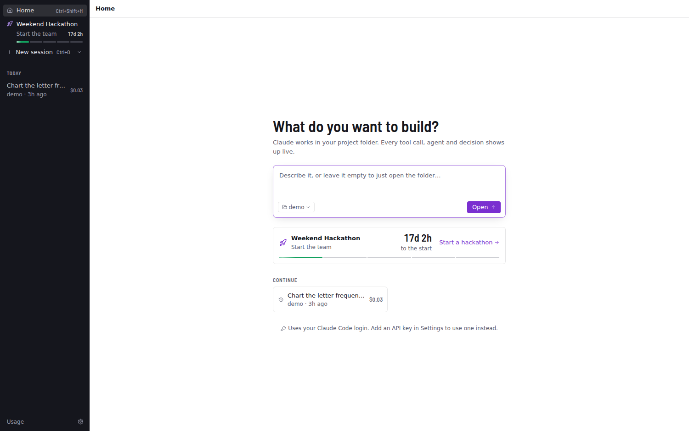

## The conversation

- **Engine:** Claude Agent SDK with streaming input, so you can queue follow-ups while Claude works. Stop with Esc. Switch model and permission mode mid-session.
- **Live conversation:** streamed markdown, collapsible thinking, and compact tool chips coloured by kind (read, write, search, exec…). Click a chip to see its input, output and diff.
- **Subagents:** each spawned agent gets a live card with its own tool calls, a progress summary and its final report. Background subagents keep running after the turn ends.
- **Permission cards:** Allow (⏎) / Always allow / Deny (⎋), with a diff preview. The dock badge and bounce fire while the app is in the background.
- **Side panel:** the task list (from `TaskCreate`/`TaskUpdate` or `TodoWrite`), changed files and a tree of agents (current tool, elapsed time, tokens); every tool call is under Agents › Activity.
- **Top bar:** the status chip (context-window gauge, plan usage, output tokens, session cost) and the turn timer.
- **Focus mode** (⌘\\), open project (⌘O), settings (⌘,).

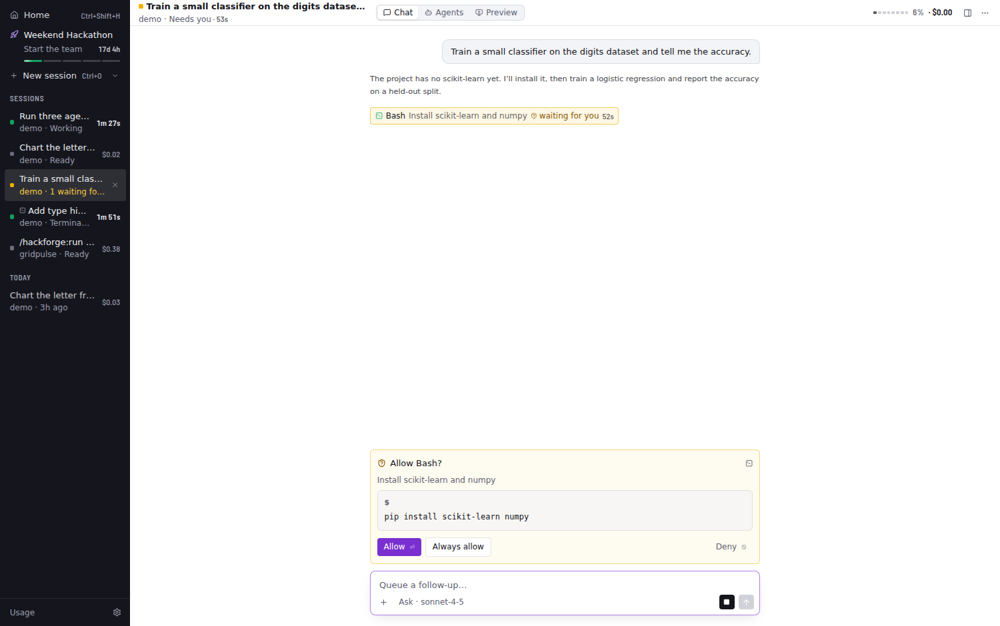

## Watching agents work

**Agents** (⌘2) shows every agent as a live card (**Cards**). Each card shows:

- **What it's doing now:** the file it's writing streams in, a running command shows its line and timer, a search shows its query.
- **Progress bars** with an ETA, and **metric charts** (loss, accuracy, …).
- **The latest result it showed:** an image, chart, table or note.
- **A strip of its tool calls**, coloured by kind.

Click a card for the full detail view: progress, one chart per metric, all results, the files it touched (click to see the diff), its whole timeline and its report.

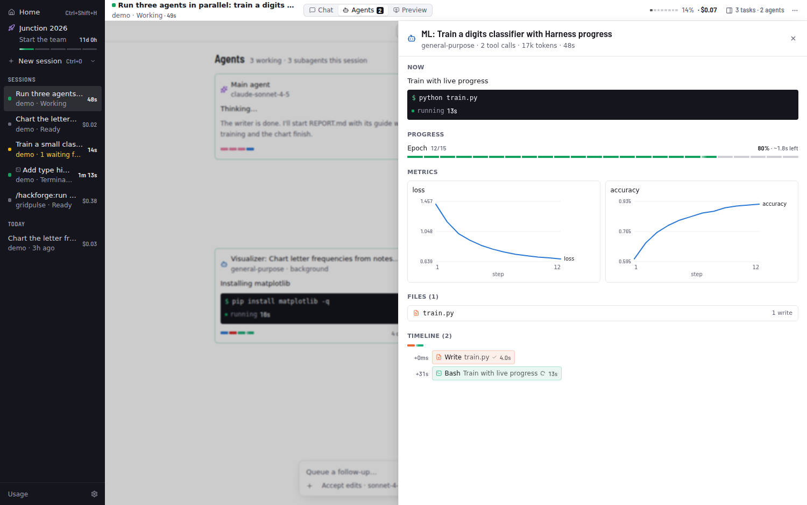

Agents feed these visuals three ways:

1. **`harness` tools.** Every agent has in-process MCP tools: `status`, `progress`, `metric` and `show`. `show` takes an image path, markdown, a table or a chart. Claude calls them between steps.
2. **`$HARNESS_URL`.** Scripts the agent runs can POST JSON there while they execute, so a training loop updates its progress bar and charts in real time. The format matches the tools, e.g. `{"kind": "progress", "label": "epoch", "current": 3, "total": 10, "metrics": {"loss": 0.42}}`.
3. **Command output.** tqdm bars, `Epoch 3/10` and `loss=0.42`-style lines are parsed automatically.

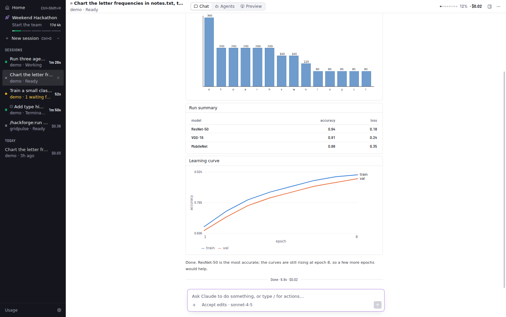

## Mission control, files and diffs

**Agents › Graph** puts two views together. On top is a live **agent graph**: the main agent and every subagent it spawns, nested by who spawned whom. Edges animate while an agent works, and each node shows its current activity, progress and recent tool calls. Below is a **timeline** with one lane per agent and a bar per tool call (colour = kind, length = duration). Parallel calls stack, and a shaded band shows each subagent's lifetime. Hover a bar for details, click it to open that call in its agent's detail view, and switch between All and Last 2 min.

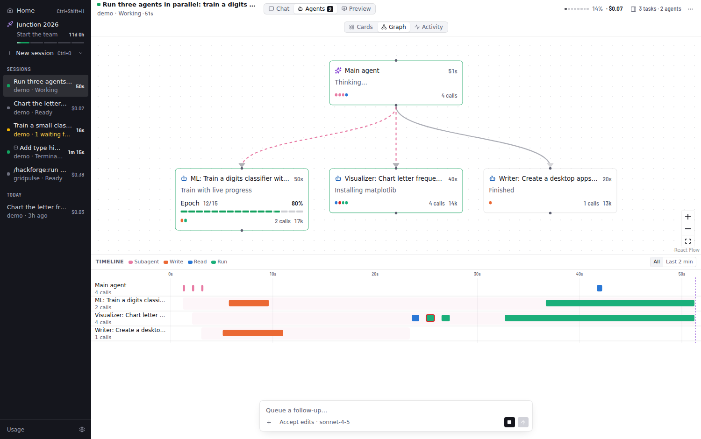

The **Files** section of the side panel (⌘I) has two parts:

- **Changes:** every file that differs from how it was before the session, with +/− counts.
- **Project tree:** a heat map where files glow blue when read, orange when written, and green when a command changed them, fading over about a minute. Folders containing touched files open automatically. Dots record what ever happened to each file.

Click a changed file for a **Monaco diff** (side by side or inline, unchanged regions folded). Step through files with the arrows, **Revert** to restore the original, or **Accept** to mark it reviewed.

How the "before" is known: the SDK's `PreToolUse` hook snapshots each file just before an agent edits it. Files changed by commands fall back to git's `HEAD` version. Snapshots are saved with the session, so diffs and reverts still work after a restart or from History.

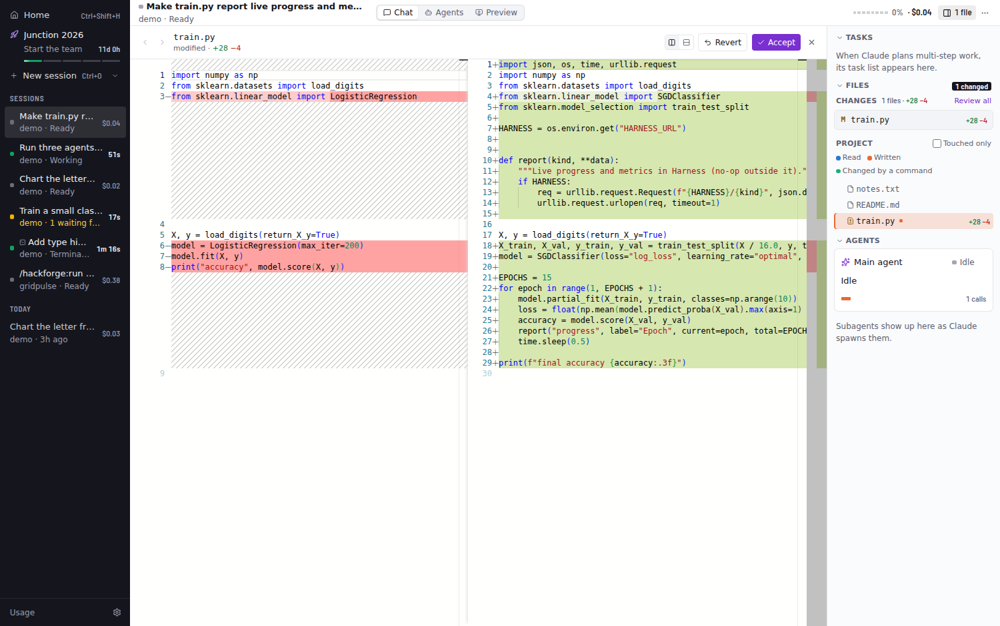

## Terminal and observe mode

**Terminal** (⌘J, or the terminal icon in the top bar) is a panel of real terminals built on node-pty and xterm.js. They open in the session's project and use your login shell, so your PATH, aliases and tools work. Tabs keep their scrollback while hidden. **✳ Claude** opens the interactive Claude Code CLI in a tab.

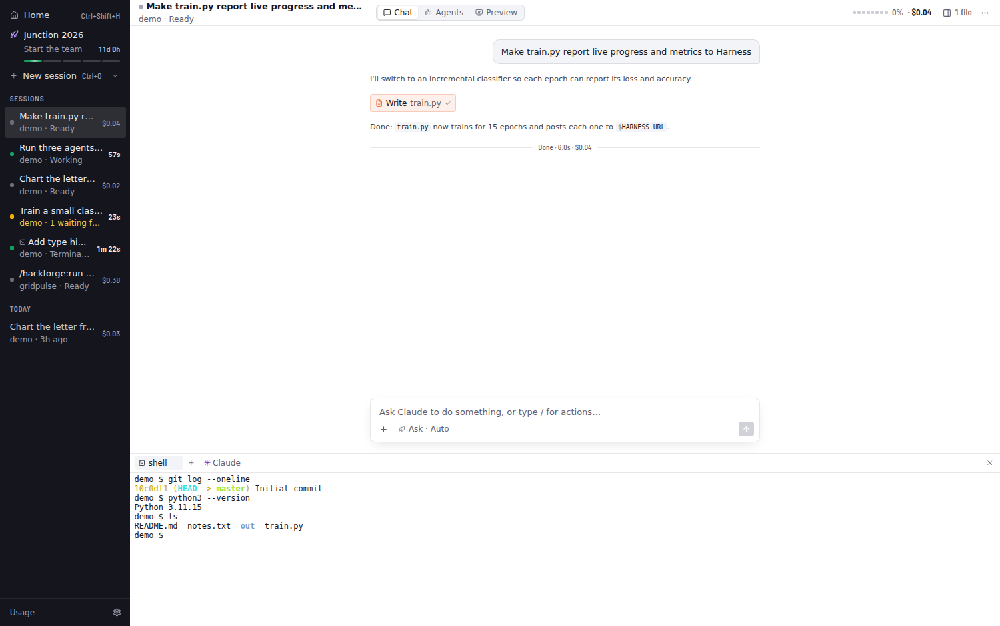

**Observe mode** shows Claude Code sessions you start outside Harness (iTerm, Terminal, an editor, `claude -p` in a script) in the sidebar with a terminal icon. You get the full live UI for them: conversation, agent cards, graph and timeline, files and cost. It needs no setup. Harness watches the transcripts Claude Code writes to `~/.claude/projects/`, attributes subagent work through each subagent's metadata file, and saves the session to History so you can resume it later. Sessions Harness runs itself, and other Agent SDK apps, are skipped.

For instant "needs approval", "done" and "ended" status, **Settings › Team → Install hooks** adds a tiny `curl` hook for four events to `~/.claude/settings.json`. The file is backed up first, existing hooks are kept, and **Remove hooks** takes out only Harness's entries. The hook never blocks or fails Claude Code (`curl -m 1 … || true`).

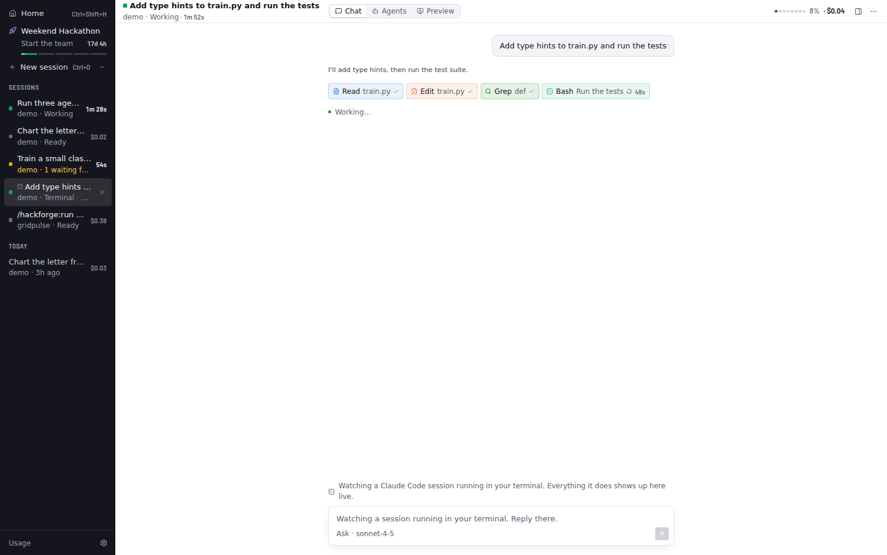

## Preview: Remotion Studio and dev servers

**Preview** (⌘3) embeds what you're building next to the agents building it. One menu at the top picks what it shows: Remotion Studio, a dev script, a server seen running, a 3D model, or a localhost URL.

- **Remotion projects** are detected from `package.json`. **Start Studio** runs the project's own Remotion CLI on a free port, with no browser window, and embeds Studio. Studio hot-reloads, so when Claude edits a composition you see the frame change right away. The side panel lists compositions (size, fps, length). **Render** shows live progress through bundling, rendering frames with time left, and encoding, plus Cancel. Finished videos play in the panel, with **Show in Finder**.
- **Dev servers:** `package.json` scripts that start a server (`dev`, `start`, `storybook`, vite/next/astro…) are in the menu. Any `localhost` URL that shows up in an agent's command output or in a terminal is offered automatically, and you can type one. Its **⋯** has reload, open in browser, server output and stop.

Remotion downloads its own headless Chrome the first time you render. Set `HARNESS_REMOTION_BROWSER` to use an existing one instead.

**Click to change.** Press **Click to change** above the preview (or use ⌘K), click any element in the running app, and type what should change.
- **What Claude gets:** the element (tag, text, a CSS selector, its classes and current style) plus a screenshot of it. In React, Vue or Svelte dev builds, it also gets the component name and, where the build records it, the source file.
- **Watching it happen:** the preview hot-reloads, so you see the change land.
- **Usage saver:** it judges these messages by what you typed, so a small visual tweak runs on Sonnet.

**3D models.** Every `.glb` or `.gltf` in the project is in Preview's menu (or use **Open a .glb or .gltf…**). The viewer:
- turns the model with the mouse, with optional auto-rotate, wireframe and background toggles;
- lists its named parts (the parts a 3D clip's exploded view separates), with click to highlight or show only that part;
- shows triangles, materials, textures, size in metres and file size, with a warning when it's too heavy for the web or a clip;
- reloads by itself when the file changes, for example after Claude re-exports it from Blender.

Its main button is **Ask Claude to change**, which sends a screenshot plus the part you picked. Its ▾ has **Use in a 3D clip** and **Open in Blender**, and **⋯** has the view toggles.

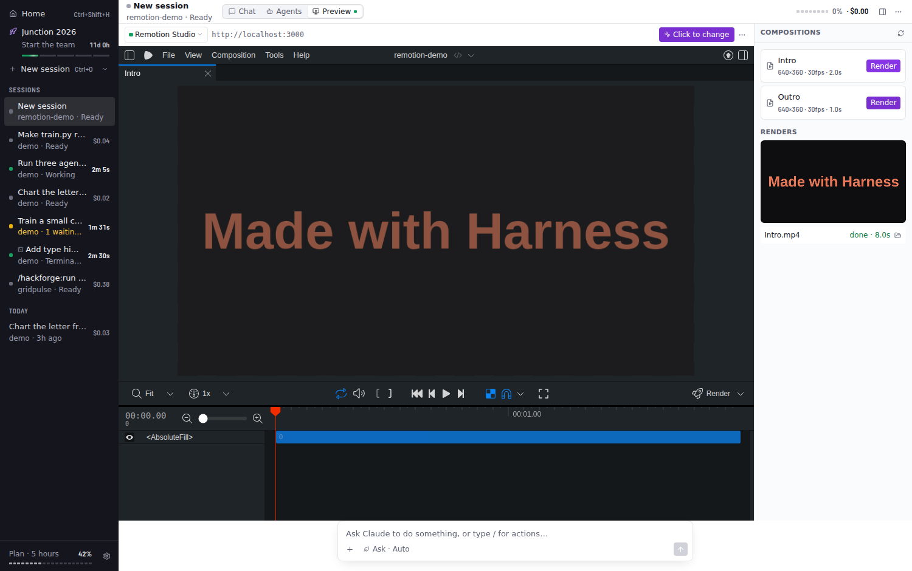

## The / menu instead of /commands

Type **/** in an empty prompt box, or press **+**, and one searchable list has everything:
- **Suggested:** the next step in a HackForge project;
- **HackForge:** its commands, once the project uses it;
- **Quick actions:** parallel agents, train a model, analyze data, fix tests, build a feature, debug, explain, Remotion video, commit;
- **Project commands:** the session's own slash commands and skills.

Type a few letters to filter it; names rank above descriptions, so `/ver` finds Verify. Each action opens a form prefilled with example parameters and a preview of the exact prompt. **Run** (⌘⏎) sends it; **Edit in prompt** drops it into the box. A full `/command with arguments` still sends as typed.

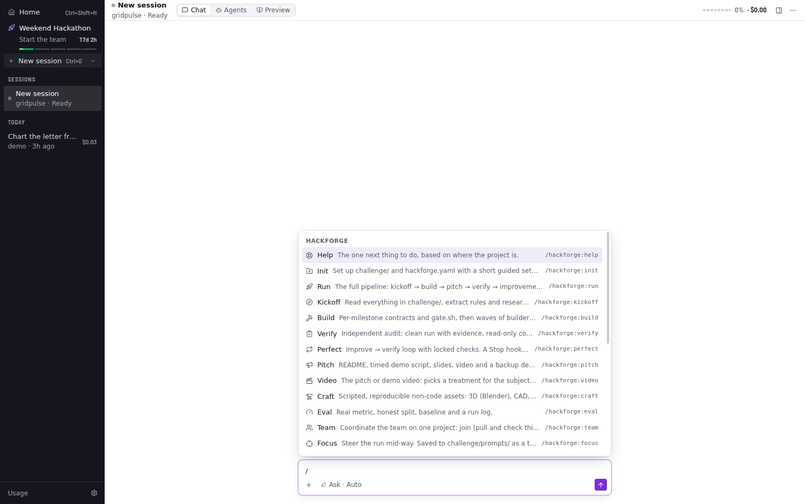

## Everyday polish

- **Readable at a glance:** the sidebar is a dark rail in light and dark mode, and four colours each mean one thing: green is working, yellow is waiting for you, red failed, violet is the best result and the main button. Progress shows as segmented bars everywhere (the team run, HackForge phases, agent progress, tool calls, plan and context usage), and every time, cost and count is set in a condensed font with even-width digits. [DESIGN.md](../DESIGN.md) has the full design system.
- **Native menu** with every command and its shortcut. It also makes ⌘C/⌘V/⌘Z work everywhere.
- **⌘K command palette:** commands, places and tabs, open sessions, History, projects, and every action from the / menu.
- **Notifications:** when Claude needs approval, or finishes a turn longer than 15 s, while Harness is in the background or you're looking at another session. Clicking a notification jumps to the session. You can turn them off in Settings.
- **Menu-bar item:** shows how many sessions are working (and `!` when one needs you), and lists them. The dock badge counts sessions waiting for approval.
- **Replay** (⇧⌘R, or ⋯ → Replay): a scrubber over the session's saved events, with play at 1×, 4×, 16× or 64×. Ticks mark prompts, finished turns and subagent launches. Every view (chat, agents, graph and timeline, files, meters) shows the session as it was at the playhead.

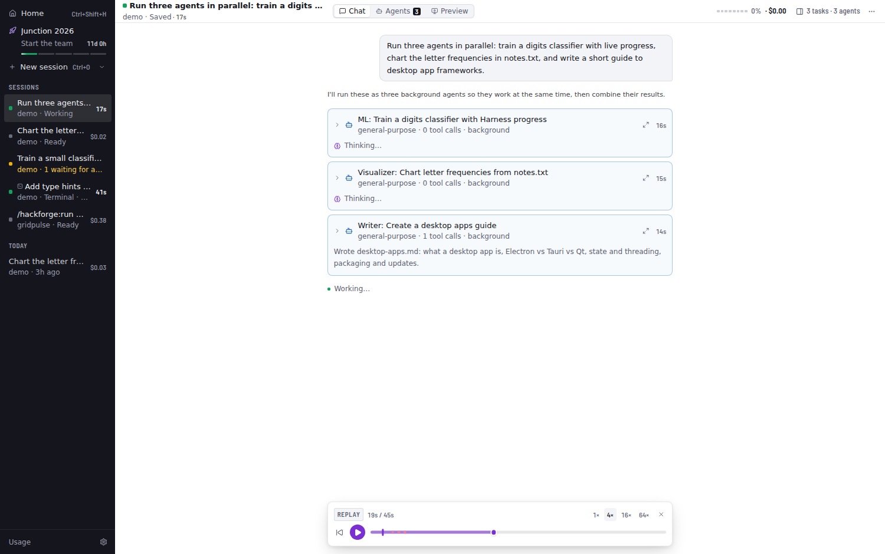

## History and resume

Every session is saved as it runs, in a local SQLite database in Harness's data folder (`~/Library/Application Support/Harness/harness.db` on macOS, `%APPDATA%\Harness\harness.db` on Windows). The app uses Node's built-in `node:sqlite`, so there's no native module to rebuild. The sidebar's **History** is grouped by day and searchable. Each entry is titled from its first prompt and shows the project, last activity and cost.

Opening a saved session replays its event log through the same reducer as live view, so you see the transcript, tool calls, subagents, charts and task list exactly as they were. **Sending a message, or using an action, resumes it.** The agent restarts with the SDK's `resume`, so Claude has the whole earlier conversation. The task list carries over, and cost keeps adding up. Closing a session (×) stops its agent; it stays in History. The trash icon deletes it.

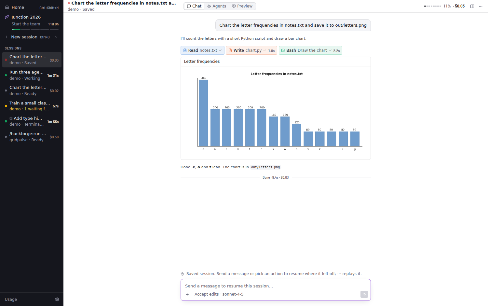
