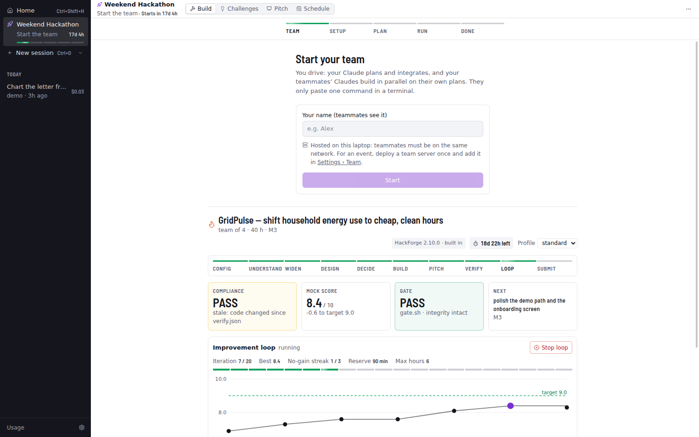
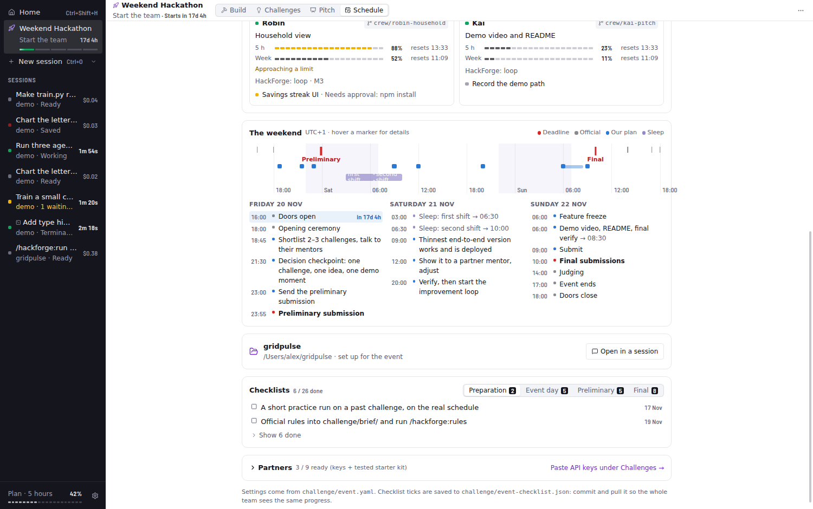
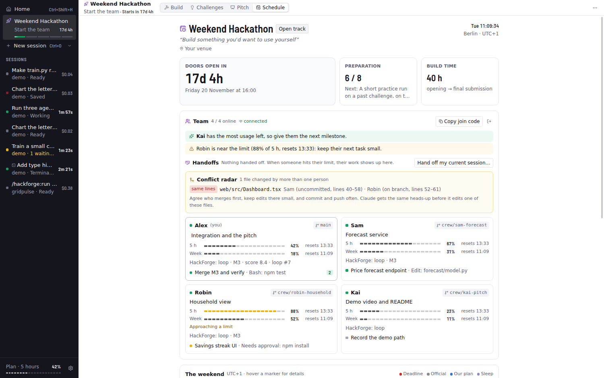
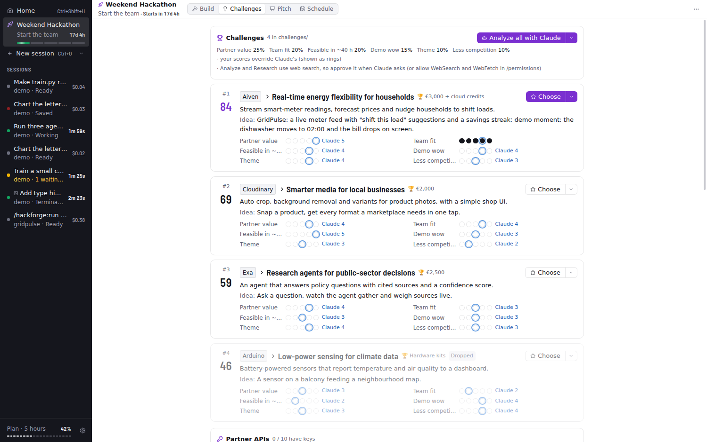
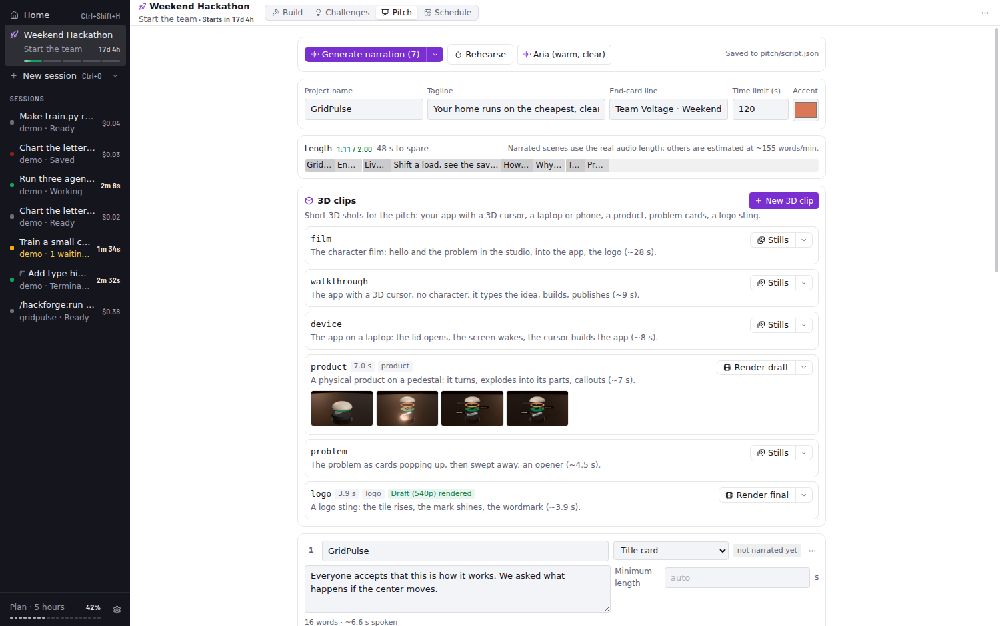
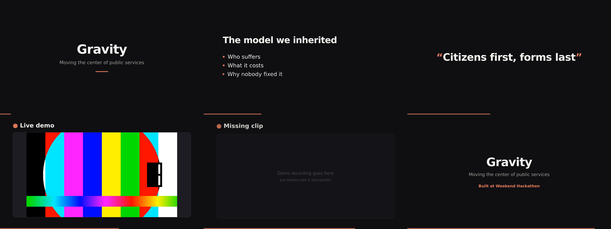

# Hackathon mode

The **Hackathon** place (⌘4) carries one project from an empty laptop to a finished entry: the team run, the event schedule, the challenges, partner APIs and the pitch video. It works for any hackathon; a generic *Weekend Hackathon* example is built in.

← [Back to the README](../README.md)

## Team run: a hackathon in five steps



**Hackathon › Build** is the **team run**, one straight line from an empty laptop to a finished entry: **Team → Setup → Plan → Run → Done**. You drive; your teammates' Claudes build alongside yours on their own Claude plans.

1. **Team.** Type your name and press **Start**. Harness shows one command; each teammate pastes it in a terminal (`npx -y harness-crew HT1.…`) and leaves it open. That's their whole setup: Node 20+, git and a Claude login. No GitHub, no Harness. You see each teammate appear with whether they're ready and how much plan usage they have left.
2. **Setup.** Name the project, pick a folder and the deadline, and Harness creates it: git, HackForge's settings and two drop zones, **the challenge** (paste the text, drop the PDFs) and **files** (data, docs, brand kits). **Private files** are for data the rules say must not go to an AI: Claude can't read or show them (permission rules plus a hook), they stay out of git and on your laptop, and Claude only runs scripts on them that print totals. A public GitHub repository for the submission is one optional click (GitHub CLI).
3. **Plan.** **Continue** starts your Claude on HackForge: it reads the challenge, researches (handing research and architect work to ready teammates' Claudes), weighs options and stops with a plan. You read the decision and the milestones and press **Accept and run**, or **Ask for changes**.
4. **Run.** Your Claude freezes the interfaces and writes a contract per milestone; then Harness runs the build milestone by milestone. It gives each task to a teammate's Claude (one each, whoever has the most usage left) and the rest to yours, keeps your own usage for integrating when it runs low, and tells your Claude in "[run]" messages when to build its part, when to merge the crew's branches and verify, and when to move on. Work that fails moves to someone else or back to your Claude; a teammate whose plan runs out hands over to another, from their branch. When your own limit runs out, the run waits for the reset while the crew keeps going. Overruns and the deadline are watched: a milestone over its time-box by half gets cut down, and when time is short the remaining milestones are cut so the pitch, verification and improvement loop still happen.
5. **Done.** What got built, the mock judges' score and what they'd still fix. Harness never submits for you.

Only your screen shows everything: who's doing what, each task, the timeline, and an **Inbox** for everything that needs you: your Claude's permission prompts and questions, crew Claudes' prompts (**Allow / Always / Deny**), and decisions your Claude escalates with its suggested answer (routine crew questions it answers itself). Teammates' terminals show their own Claude working. The Claudes message each other about interface changes. Code moves between laptops through the **team server** as git bundles encrypted with the team's key: deploy one once for free (Settings › **Team** → *Deploy on Render*, then paste its address), or let your laptop host it on the same network.

Harness opens on the Hackathon while a run is planning or running. Your sessions and Home stay one click away in the sidebar.

## The event: schedule, team, partners, challenges, pitch

**⌘4**, the Hackathon row in the sidebar, or the card on Home opens the Hackathon; **Schedule** has the event's clock, team and checklists. It's reusable: everything comes from an `event.yaml`. Harness ships with a generic **Weekend Hackathon** example (a 48-hour event whose dates always lie a couple of weeks ahead, in your time zone); for your own event, edit `challenge/event.yaml` in the event project and the Hackathon follows it.

- **Clock:** a countdown to the doors opening, then to the next deadline (amber 3 h before, red in the last hour), the next step of the plan, and who is asleep right now. Times are shown in the event's time zone (any IANA zone, so daylight-saving switches are handled).
- **The weekend:** one timeline with official times, the submission deadlines, your plan and sleep shifts, plus an agenda per day.
- **Event project:** one click sets up a folder (or an existing repo) for the event:
  - `challenge/event.yaml` (schedule, partners, checklists; edit it freely)
  - an event brief and a strategy directive that HackForge reads
  - HackForge settings for the event (in the example: 40 h, team of 4, the final deadline, the loop stopping 4 h before it, cheaper models for builders and stronger ones for the architect and judges)
- **Checklists:** preparation (week by week up to the event), event-day logistics, the preliminary submission and the final submission, in one card that opens on the list that matters now (the open item due soonest). Done items fold away, each item has a due time, and overdue ones turn red.
- **Partners board:** the event's partners by category (the example lists sponsors Harness has API kits for), each with *Keys* (account and API key ready) and *Kit* (starter kit tested) toggles. It stays folded to a ready count until you open it.
- Ticks are saved to `challenge/event-checklist.json`. Commit it, and the team shares one checklist through git.



### Team board

The **Team** panel under **Schedule** shows every teammate's laptop in one place. Each teammate keeps using their own Claude login, and their Harness shares a small status through a relay:
- what they're working on and their git branch
- their open sessions, with what the agent is doing right now
- their HackForge phase and score
- **how much of their Claude plan is left** (5-hour and weekly windows, with reset times)

Harness suggests who should take the next milestone (the person with the most usage left) and warns when someone is close to or at a limit. Your own 5-hour usage also shows in the top bar.

- **Create the team** by hosting the relay on one laptop (same network, good for practice), or point it at a relay server. For an event, [`relay/`](../relay/README.md) is one dependency-free Node file plus a Dockerfile, deployable to any host with HTTPS.
- **Join** with the join code from **Copy join code**.
- Plan usage comes from what Claude Code reports while a session runs, so a teammate's numbers appear after their first session. With an API key set in Settings, the board shows "API key" instead.



**Conflict radar.** Every laptop scans the event project (files changed since its branch left main, committed or not, with the changed line ranges) and shares the list through the relay.
- The Team board lists files two people are changing, marked **same lines** (merging will conflict) or **same file** (different parts).
- A new conflict sends a notification to both laptops (and their phones, with phone alerts on).
- Before Claude edits one of those files, it gets a heads-up to keep the edit small, and the chat shows a note. Lockfiles and build output are left out.

**Handoff when the limit runs out.** When your usage limit is reached, a banner above the prompt offers **Hand off to the team**. It's also on the Team board and in ⌘K.
- **The note:** Harness writes it from the session itself (what was asked, the task list, changed files, where it stopped), so it works even with no usage left. You can edit it before sending.
- **The work:** your folder, uncommitted work included, is pushed as a `handoff/<name>-<time>` branch. The commit is built in a temporary git index, so your own branch, staging area and files stay exactly as they were.
- **Taking it over:** teammates get a notification. **Take over** checks the branch out as a git worktree next to their project (their own folder untouched), copies `.env`, and opens a session with the first message ready.

**Run when the limit resets.** At the limit, pressing Enter queues the message instead of sending it. Near the limit, the ⏰ button by Send does the same.
- **When it runs:** queued messages are saved and sent when the limit resets, one at a time per session. A laptop that slept through the reset catches up when it wakes.
- **Switching it off:** use **Run at reset** in the banner, the queue list or Settings; messages then just wait.
- **Keeping the laptop awake** is optional. Closing a laptop's lid still puts it to sleep.

**Phone alerts.** Settings › General → Phone alerts: install the free [ntfy](https://ntfy.sh) app, scan the QR code, and press **Send a test**. You get a push when:
- Claude needs approval
- a long task or a HackForge loop finishes
- your limit is hit, or queued messages run
- a teammate hands off work, or a file conflict appears

By default it only pushes when you're away (screen locked or idle). Each laptop gets its own long random topic, and alerts never contain code or keys.

### Crew mode

Only the driver runs Harness. Teammates lend their Claude from a terminal, with no app to install:

```bash
npx -y harness-crew HT1.xxxxxxxx      # the command on the Team screen (or the Team board's Crew card)
```

From then on nobody else types anything. In a [team run](#team-run-a-hackathon-in-five-steps) Harness hands out the tasks; in any other session in a team, your Claude splits the work and hands missions to the crew itself. Their Claudes work in parallel on their own laptops and Claude plans.

- **Missions:** your Claude calls `crew_dispatch` with a self-contained brief per task. Each mission runs in a fresh Claude Code session on the teammate's laptop, on its own branch (`crew/<name>/<mission>`), with HackForge's builder rules, the design skills, library docs (Context7) and a browser (their Chrome or Edge) to check frontend work. When their Claude reports, harness-crew commits what's left and sends the branch back through the team server: it appears in your repository as `crew/<name>/<mission>`, ready to merge.
- **Usage-aware:** a mission goes to the idle teammate with the most plan usage left (`crew_status` shows everyone's, yours included). If someone's plan runs out mid-mission, the work so far is sent and the mission moves to whoever has usage left, continuing from that branch.
- **Reports come back by themselves:** your Claude collects them with `crew_wait`, or they arrive in the session that sent the mission as a **Crew** message, so it keeps going: merge, run the checks, dispatch the next wave. Switch that off on the Crew card if you'd rather read them yourself.
- **The Claudes talk to each other:** a crew Claude can ask yours a question and wait for the answer, tell a teammate's Claude about an interface change, and see who is changing which files. The Crew card shows the messages.
- **Approvals:** file edits and normal dev commands (npm, node, python, pytest, git add/commit…) run without asking. Anything else shows up on the Crew card as **Allow / Always / Deny** (and on your phone with phone alerts on). Unanswered questions are denied after 10 minutes. Crew Claudes never push or merge; harness-crew sends their branch.
- **The Crew card** on the Team board shows the project crew members get (or what's in the way: no commits yet, uncommitted changes), each crew member (ready, working on what, usage left, problems), every mission with its live activity, branch, files and report, and a Stop button.
- **At the venue,** laptop-to-laptop traffic is often blocked, so use a team server on Render instead of your laptop: one click, free (Settings › Team, or [relay/README.md](../relay/README.md)). A phone hotspot is the fallback.
- **What teammates need:** Node 20+, git and a Claude login (harness-crew asks them to sign in the first time). No GitHub access: the project goes to them and their work comes back through the team server as git bundles (40 MB each at most), encrypted with the team key. The package lives in [`crew/`](../crew/README.md).

### Partner APIs

**Hackathon › Challenges** has a **Partner APIs** kit for each event partner with an API (built-in kits: Exa, OpenAI, Featherless, Cloudinary, Modal, Aiven, Hostinger, Arduino, Verda and Cala). Paste a key and it works:
- **`.env`:** it goes into Harness's own block in the event project's `.env`. `.env` is added to `.gitignore`, and nothing else in the file changes.
- **Sessions:** every Claude session in the project (and in handoff folders) gets it as an environment variable.
- **Teammates:** with **share with team** on, they get it too, encrypted with your team code so the relay only sees ciphertext.
- **Kit notes for Claude:** `challenge/partners/` gets one note per partner with the variable names, install command and a minimal working example, plus an index of which keys are ready. HackForge's kickoff reads them.
- **Checked on save:** a saved key is tried with a cheap request where the API has one (again from the card's **⋯**, which also has the docs, the signup page and the install command).
- **Unconfirmed details:** kits whose API details couldn't be checked are marked "check at the event". Their cards take a docs link. **Add another API** covers any partner without a built-in kit, or anything new that turns up at the venue.

Keys are stored in the macOS Keychain or Windows' DPAPI (an owner-only file where neither exists).

### Challenge board

The **Challenges** tab in the Hackathon. At the opening ceremony, use **Paste all** with the challenge page's text, and Claude splits it into one file per challenge in `challenges/` (outside `challenge/`, so HackForge only ever reads the one you pick).

- **Analyze all with Claude** researches each partner and adds a summary, an idea with its demo moment, the partner technology it would run on, risks, and scores for six weighted criteria: partner value 25 %, team fit 20 %, feasible in ~40 h 20 %, demo wow 15 %, theme 10 %, less competition 10 %.
- Click the dots to give your own scores. They override Claude's, which show as rings.
- Each challenge has mentor notes. Its ▾ has **Analyze with Claude**, **Research the partner**, **Shortlist** and **Drop**.
- **Choose** writes `challenge/brief/00-chosen-challenge.md` (description, mentor notes, starting idea) for HackForge, names the challenge in `hackforge.yaml`, and ticks "Challenge chosen" on the preliminary checklist.

Prompts sent from the Hackathon go to a Claude session in the event project while you stay on the board. If Claude needs approval (e.g. for web search), the notice turns amber.



### Pitch studio

The **Pitch** tab creates `pitch/`, a Remotion video driven by `pitch/script.json`:
- **Scenes:** title, bullet points, big statement, demo clip or screenshot, and end card, with a progress bar.
- **Starter script:** the stage arc (the inherited model → the flip → live demo → how it works → why it matters).

- **One next step:** the main button follows the pipeline: Install Remotion → Write the script with Claude → Generate narration → Preview & render. The rest is behind its ▾.
- **Write the script with Claude** writes the script from `.hackforge/` (decision, plan, demo, verify) to fit the time limit.
- **Narration with ElevenLabs:** pick a narrator in the toolbar's voice chip, then **Generate narration**. Only scenes whose text or voice changed are regenerated (files are content-hashed, so there are no repeat charges), and the video times each scene to its real audio length.
- **Editor:** the length is shown against the time limit; edits save to `script.json` automatically.
- **Rehearse:** a full-screen teleprompter with the video's timing, per-scene countdowns and the overall clock.
- **Preview & render:** opens Remotion Studio and Render on the Preview tab. The output is `pitch/out/pitch.mp4`.

**3D clips** are short 3D shots made with HackForge's 3D kit (Three.js in a hidden Chrome, so no GPU is needed): your real app driven by a 3D cursor, the app on a laptop or phone, a product exploding into its parts with labels, the problem as cards, or a logo sting.
- **Setup:** once per project. **Set up the 3D kit** copies the kit into `video/kit3d/` and installs what it renders with (about 300 MB). A checklist says what's missing first: Python 3.10+, ffmpeg, a browser, npm.
- **New 3D clip:** pick a type and describe it in a line. Claude writes the clip for your app and brand.
- **Each clip** has one next step, with the rest behind its ▾:
  - **Stills:** a quick look in about a minute;
  - **Render draft** (540p), then **Render final** (1080p): a progress bar with frames and time left, and **Stop**. Rendering again picks up where it stopped;
  - **Add to pitch:** it goes into `pitch/public/3d/` and into a demo-clip scene before the end card;
  - **Play;**
  - **Ask Claude to change it.**

  The clips carry their sound effects; the pitch brings narration and music. A clip that speaks (the mascot film) keeps its own voice.

The ElevenLabs key is stored in the Keychain, or read from `ELEVENLABS_API_KEY`.




