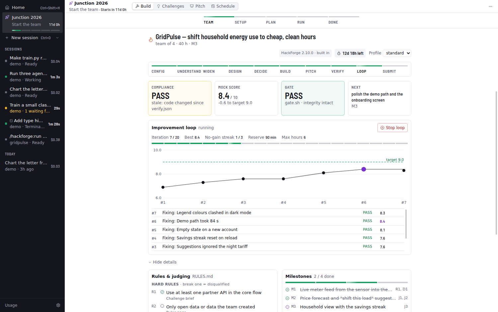
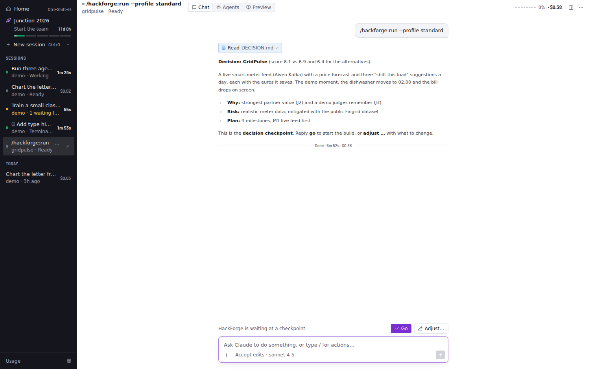

# HackForge

The Claude Code plugin for hackathons and coding challenges, built into Harness.

← [Back to the README](../README.md)

Harness is built to drive **HackForge**, the Claude Code plugin for hackathons and coding challenges. **HackForge is built in:** Harness ships a copy in `resources/hackforge` (currently 2.10.0) and loads it into every session through the Agent SDK, so there's nothing to install. If you've also installed HackForge yourself (`claude plugin install hackforge@veeti-tools`) and that copy is newer, Harness uses yours instead. It never loads both. The dashboard shows which one is in use.

HackForge's hooks run Python 3 (macOS has it with the Xcode command-line tools; Windows: see [WINDOWS.md](WINDOWS.md)).

- **Automatic in HackForge projects.** When a project has `challenge/` or `.hackforge/`, every session gets instructions to work through the `/hackforge:*` skills and keep `.hackforge/` current. **Settings › Tools → HackForge** switches this to *always* (suggest HackForge in every session) or *off*.
- **Buttons for every command:**
  - **Getting started:** Help (the one next step), Init.
  - **Running it:** Run (with a profile picker that writes `profile:` to `challenge/hackforge.yaml`, including `lean` for Pro plans), Kickoff, Build.
  - **Checking and improving:** Verify (quick, full or final), Perfect (target, max iterations, `--hours`…).
  - **Pitch and assets:** Pitch, Video, Craft, Eval.
  - **Coordination and wrap-up:** Team (join, who, claim, handoff, driver), Focus, Rules, Views, Status, Retro.

  Before kickoff only the setup commands show.
- **HackForge dashboard** (Hackathon › Build; the session's side panel has a summary with the next step). It reads `.hackforge/` live as the agents write it:
  - the phase stepper (config → submit) and a deadline countdown
  - COMPLIANCE, flagged *stale* when code changed after the last verify, as the loop gate would; MOCK_SCORE against the target; whether it was a quick or full verify; the gate result and the integrity lock; and the next action. It reads `verify.json` (HackForge 2.x) or `VERIFY.md` (1.x).
  - the fix order with each finding's severity, the blind judge's first impression, and claims nobody could check yet
  - the improvement loop: iteration / max, best score, the no-gain streak against the plateau limit, a score chart with the target line, every iteration (from `ledger.jsonl` and `LOOP.md`) kept or reverted, and the advisor's decisions when the loop gets stuck
  - buttons for HackForge's HTML decision pages (`/hackforge:views`)
  - **Stop loop**, which creates `.hackforge/STOP_LOOP`
  - hard rules and deliverables with their compliance checks, judging criteria with weights and per-criterion mock scores, milestones, the fix order, team directives and the decision
- **Checkpoints:** when HackForge stops for "go / adjust", **Go** and **Adjust…** buttons appear above the prompt. Questions Claude asks with AskUserQuestion appear as a card with option buttons and a free-text answer.
- HackForge's subagents show up by role (Rules Lawyer, Judge, Builder…) on the agent cards and in the graph.
- A hint suggests **Accept edits** while the loop runs, because every permission prompt pauses it.
- The pitch studio's **3D / animated clips** button runs `/hackforge:video`, which adds clips to `pitch/public/` as screen scenes.

## What's new in recent versions

- **Design skills** (2.2.0): build writes one `DESIGN.md` design system before frontend work and freezes it with the contracts; frontend builders load impeccable, and its findings become evidence for the verifier, the judges and the fix order.
- **Dev tools** (2.3.0): the verifier walks the demo path in the browser and saves named screenshots to `.hackforge/evidence/`; builders check their screens in the browser and look APIs up with Context7.
- **Crew** (2.4.0) and **team runs** (2.5.0): build hands tasks to teammates' Claudes as missions and follows Harness's "[run]" messages in a [team run](HACKATHON.md#team-run-a-hackathon-in-five-steps); crew branches arrive through the team server.
- **Mascot** (2.6.0–2.7.0, optional): `/hackforge:mascot` designs a character that becomes the assistant's face in the app, the logo, and the star of a 30–40 s film rendered with Three.js in headless Chrome (no GPU needed).
- **3D pitch kit** (2.8.0): `/hackforge:video` cuts short 3D clips into the pitch video (the real app driven by a 3D cursor, the app on a laptop or phone, an exploding product, popping problem cards, a logo sting), keeping a 3D scene only when a blind judge prefers it.
- **Reverse engineering** (2.9.0, with REA on): the researcher maps a partner's real API with evidence, and `/hackforge:solve` takes on reversing tasks.
- **Live Blender and 3D in the app** (2.10.0): the craftsman builds 3D models in your open Blender; Hackathon › Pitch renders 3D clips and Preview shows any `.glb`.

The full history is in [resources/hackforge/CHANGELOG.md](../resources/hackforge/CHANGELOG.md).

