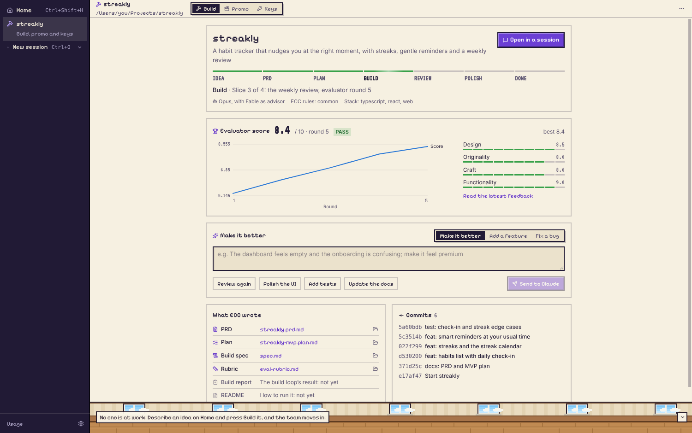
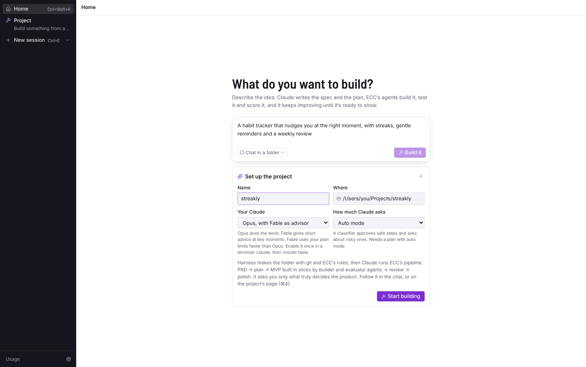
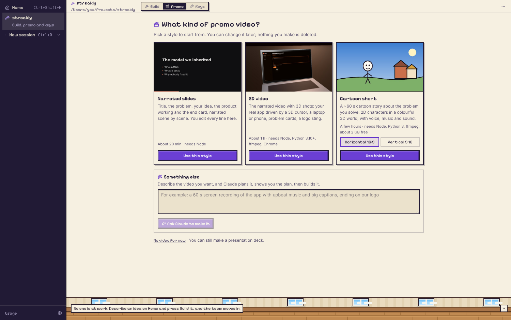
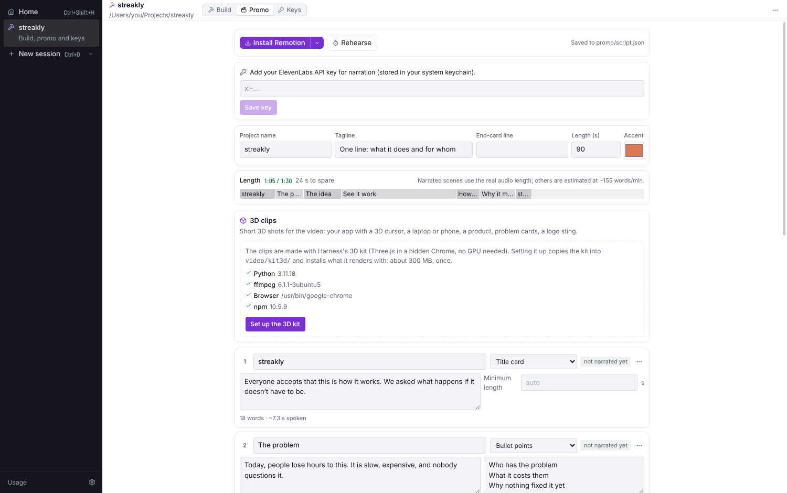
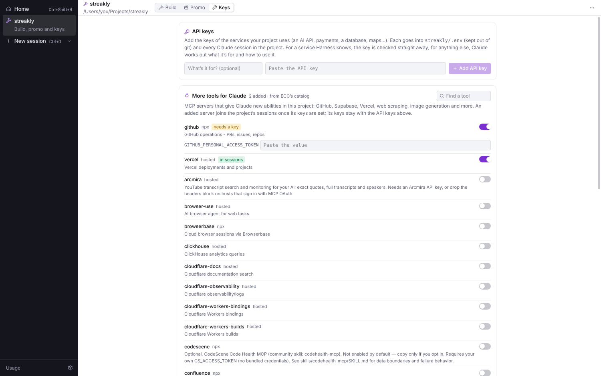
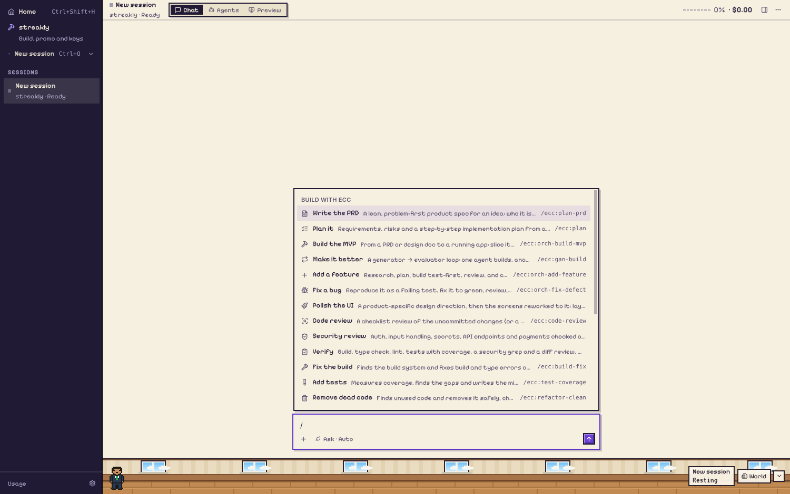

# Projects: from one idea to a finished product

Describe what you want to build. Harness sets up the project, and Claude builds it with [ECC](https://github.com/affaan-m/ECC)'s planners, builders, evaluators and reviewers. It keeps improving the product until it's something you'd be proud to show. You follow along on one page and step in when you want.

← [Back to the README](../README.md)

## Build it

On **Home**, describe the idea in a sentence or two and press **Build it**. Set up four things, then press **Start building**:

- **Name:** suggested from your idea, used for the folder.
- **Where:** the folder it goes in. It remembers the last one; the first time it's `~/Projects`.
- **Your Claude:**
  - **Opus with Fable as advisor** (the default): Opus does the work, and Fable gives short advice at key moments, like locking the plan or a score that stops improving. See [Usage](USAGE.md#advisor) for limits and the one-time `/model fable` step.
  - **Opus** alone.
  - **Your default** from Settings.
- **How much Claude asks:**
  - **Auto mode** (the default): Claude Code's classifier approves safe steps and asks about risky ones. It needs a plan that has auto mode.
  - **Ask before commands:** file edits go ahead, and every command waits for your OK.

Harness then:
1. creates the folder with git (a `main` branch and a first commit, using your git identity);
2. adds a `.gitignore` that keeps `.env`, dependencies and build output out of git;
3. copies ECC's common rules into `.claude/rules/ecc/common/`;
4. records the project in `.harness/project.json`;
5. makes it the current project, starts a session in it, and sends one message: the build instructions. In the chat they show as **Sent by Harness**, collapsed to their first line.

## What Claude does

The instructions run ECC's pipeline in order. Claude reports each stage to Harness as it goes.

| Stage | What happens | What it leaves |
|---|---|---|
| **PRD** | `/ecc:plan-prd`: who it's for, the problem, the hypothesis, the MVP and what's out of scope. Claude answers ECC's framing questions itself and marks them as assumptions. It asks you only what truly decides the product: once, at most three short questions. | `.claude/prds/<name>.prd.md` |
| **Plan** | `/ecc:plan`: a modern, fitting stack (it says why) and the steps | `.claude/plans/<name>.plan.md` |
| **Build** | `/ecc:orch-build-mvp`: thin end-to-end slices. Each one is built by ECC's generator agent and scored in the running app by its evaluator agent (design, originality, craft, functionality) until it reaches 8/10 or stops improving. A slice is reviewed, then committed as its own `feat:` commit. | `gan-harness/spec.md`, `eval-rubric.md`, `feedback/feedback-NNN.md`, commits |
| **Review** | `/ecc:code-review`, the security-review skill, then the verification loop until it passes | fixes, a PASS report |
| **Polish** | A design pass with the frontend-design-direction skill, and a README with a screenshot | `README.md`, `docs/screenshots/` |
| **Done** | A short summary, how to run it, and the three best next improvements | |

A few rules apply throughout:
- Claude only claims what really works: it runs the app and its tests itself, and looks at the UI in Harness's browser.
- Secrets stay in `.env`.
- If something needs a key or a paid service you haven't added, Claude puts a mock behind a clean interface, notes it in the README, and keeps going.
- It stops only for a question that truly blocks, or before anything risky: deleting data, spending money, publishing or force-pushing.

**Watch it work:** the chat shows every step, and **Agents** (⌘2) shows ECC's agents live as cards, a graph and a timeline. When Claude asks you something, the session turns yellow and the question waits in the chat. It's never a dead end: you can stop, steer or add to it at any time, as in any session.

**A real build needs your Claude login and takes a while:** expect an hour or more of Claude time for a small app, more with many slices. Plan usage shows in the status chip, and [the Usage saver](USAGE.md) and run-at-reset still apply.

## The Project place

**Project** (⌘4, or the project row in the sidebar) is the current project's page, in three tabs. Its **⋯** menu can open it in a session, show it in your file manager, switch to a recent project, use a different folder, or close it (nothing is deleted).

### Build

- **The stepper:** Idea → PRD → Plan → Build → Review → Polish → Done, with Claude's latest note. It follows what Claude reports and what ECC writes, so it's right even if a report is missed.
- **The team:** the build's agents as pixel characters at work: the manager handing out work, builders hammering, scientists checking. Click one to open its agent. [More](FEATURES.md#the-team).
- **Watch in chat** and **Agents** open the build session. When Claude is waiting for you, the button says **Claude needs you**.
- **Evaluator score:** the weighted score per round as a chart, the latest round's four criteria, its verdict and a link to the feedback.
- **Make it better:** say what should be better and send it:
  - **Make it better** runs a new builder/evaluator loop on your ask (`/ecc:gan-build`). In a built project, the ask is added to the spec and rubric first, so the evaluator scores what you asked for.
  - **Add a feature** runs `/ecc:orch-add-feature`: research, plan, build test-first, review, commit.
  - **Fix a bug** runs `/ecc:orch-fix-defect`: reproduce it as a failing test, fix it, review, commit.
  - Or one click: **Review again**, **Polish the UI**, **Add tests** or **Update the docs**.
- **What ECC wrote:** the PRD, plan, build spec, rubric, build report and README, each opening in its own app.
- **Commits:** the count and the latest ones.

A folder you picked yourself works too. **Run ECC's whole pipeline** reads what's there and takes it from wherever it is.

### Promo

A promo video and a presentation deck for the project, made from its README, PRD and plan, and the app itself. It starts with one question, **What kind of promo video?**

- **Narrated slides:** a Remotion video in `promo/`, driven by `promo/script.json`. The scenes are title, bullets, big statement, demo clip or screenshot, and end card. The starter script follows a product arc: the problem, the idea, the product working, how it works, why it matters.
- **3D video:** the same video with 3D shots from Harness's 3D kit. **Make the 3D video with Claude** writes the script if needed, picks the shots, renders them and puts them in the video.
- **Cartoon short:** a ~60 s cartoon story about the problem you solve, in 16:9 or 9:16. Harness downloads the [cartoon short skill](https://github.com/mromidev/claude-animated-shorts) (MIT) once, then Claude makes it in `video/cartoon/` in a new session. It shows you the script before rendering anything heavy.
- **Something else:** describe the video; Claude plans it, shows you the plan, then builds it.
- **No video for now.**

The slide video's main button follows the pipeline: **Install Remotion → Write the script with Claude → Generate narration → Preview & render**.
- **Narration with ElevenLabs:** only scenes whose text or voice changed are regenerated, and each scene is timed to its real audio.
- **Length:** 1:30 by default, editable. The timing bar shows what's over.
- **Rehearse:** a full-screen teleprompter with the video's timing.
- **Preview & render:** opens Remotion Studio, and the video renders to `promo/out/`.

**3D clips** are short shots made with Three.js in a hidden Chrome, so no GPU is needed: your real app driven by a 3D cursor, the app on a laptop or phone, a product exploding into its labelled parts, the problem as cards, or a logo sting.
- **Setup:** done once per project; it needs Python 3.10+, ffmpeg, a browser and npm.
- **Each clip:** stills, then a draft render, then the final; each goes into the video with one click.

**Presentation deck (PDF):** Claude builds 8–10 slides from what the project really does. Their source stays in `promo/deck/`, and the PDF is `promo/deck.pdf`.

### Keys

**API keys** for the services the project uses (an AI API, payments, a database, maps…). Paste a key, optionally say what it's for, and press **Add API key**.
- **Services Harness knows** (Exa, OpenAI, Featherless, Cloudinary, Modal, Aiven, Hostinger, Arduino, Verda, Cala):
  - the key is checked straight away with a cheap request;
  - Claude gets a usage note with the variable names, install command and a working example;
  - sessions get the service's MCP tools where it has them.
- **Anything else:** Claude works it out in a new session.
  - It identifies the service without ever printing the key, finds the docs, and makes one cheap read-only call to see whether the key works.
  - It writes `.harness/services/<id>.md`, with ideas for using it in the product.
  - The card fills in as it goes.
- **Where keys go:**
  - into Harness's own block in the project's `.env` (git ignores `.env`, and nothing else in the file changes);
  - to every Claude session in the project, as environment variables;
  - into the system keychain (macOS Keychain or Windows DPAPI).

**More tools for Claude** is [ECC's catalog](https://github.com/affaan-m/ECC/tree/main/mcp-configs) of MCP servers: GitHub, Supabase, Vercel, Railway, Cloudflare, Firecrawl, fal.ai, Browserbase and more.
- **Adding a server:** switch it on. It joins the project's sessions once its keys are set.
- **Keys:** a missing one gets a field right there, and it's stored with the API keys. Keys are never written into a project file: the project records only which servers you added.
- **What's left out:** servers that need a program you install yourself, a local path, or that Harness already gives every session (the browser, library docs).

## ECC in every session

ECC is built into Harness and loads in every session, not only in projects. It brings 72 agents, 327 skills and 98 commands, all as `/ecc:…`.
- **The / menu and ⌘K:** both offer its build flow first: Write the PRD, Plan it, Build the MVP, Make it better, Add a feature, Fix a bug, Polish the UI, Code review, Security review, Verify, Fix the build, Add tests, Remove dead code, Update the docs. Type `/ecc:` for the rest.
- **Hooks:** they check edits and stop risky commands. **Settings › Tools → ECC** picks their profile:
  - **Minimal:** safety checks only.
  - **Standard** (the default): safety, formatting and session memory.
  - **Strict:** everything, with stricter gates.
  The same row turns ECC off.
- **Rules:** projects Harness creates get ECC's rules in `.claude/rules/ecc/`: the common pack at once, and the packs for the stack (TypeScript, React, Python, Go…) once its files show up. A pack you delete stays deleted; a folder you picked keeps its own rules.
- **Already installed in Claude Code?** If `ecc@ecc` is installed and newer, Harness uses yours instead, never both. To update the built-in copy from a checkout, run `npm run ecc:sync -- <path>`.

